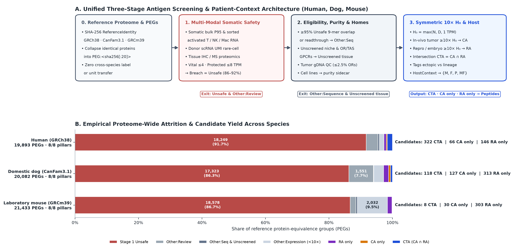
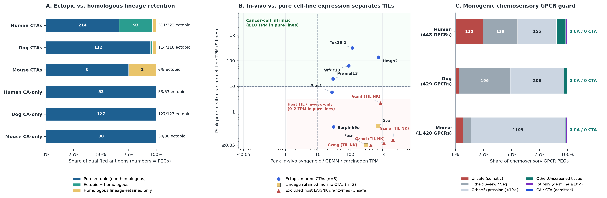
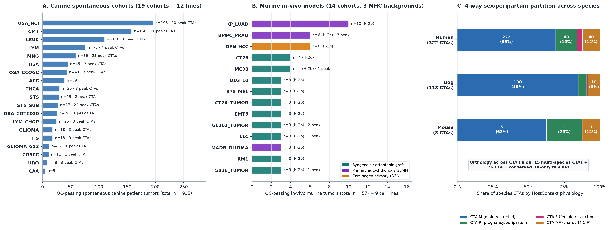

# Multi-species antigen whitepaper: human, canine, and murine parameterization

*[Interactive antigen explorer](antigen-explorer.html) · [Main antigen whitepaper](antigen-whitepaper.md) · [Species & data groups API](species.md) · [Dataset bindings (CSV)](antigen-whitepaper/species-datasets.csv) · [Non-human nominations (CSV)](antigen-whitepaper/species-nominations.csv) · [Cross-species orthologs (CSV)](antigen-whitepaper/cross-species-orthologs.csv)*

<p class="section-nav"><strong>Jump to:</strong> <a href="#goals-and-species-invariant-architecture">Goals &amp; architecture</a> · <a href="#ectopic-activation-in-vivo-purity-and-chemosensory-gpcr-guards">Ectopic, TILs &amp; GPCRs</a> · <a href="#comparative-anatomy-and-sex-restricted-subsets">Anatomy &amp; sex subsets</a> · <a href="#eight-pillar-cross-species-parameterization-matrix">8-pillar matrix</a> · <a href="#homo-sapiens-human-taxon-9606">Human (9606)</a> · <a href="#canis-lupus-familiaris-domestic-dog-taxon-9615">Dog (9615)</a> · <a href="#mus-musculus-laboratory-mouse-taxon-10090">Mouse (10090)</a> · <a href="#cross-species-cta-orthology-across-human-dog-and-mouse">Cross-species orthology</a> · <a href="#programmatic-and-cli-access">API &amp; CLI</a></p>

## Abstract

Translational cancer immunotherapy moves vaccine constructs, T-cell receptor designs, and preclinical safety benchmarks across humans, outbred companion dogs with spontaneous cancers, and syngeneic or genetically engineered mouse models. Treating "cancer–testis antigen (`CTA`)" as a human gene list projected onto animals by symbol orthology fails in both directions: `CT-X` and zygotic-genome-activation (`ZGA`) gene arrays evolve rapidly across mammals (`NY-ESO-1`, `SPANX`, `VCX/Y`, `GAGE`, `XAGE`, `DUX4`, `PRAMEF` vs. murine `Mageb`, `Pramel`, `Sbp`, `Pbsn`), accessory reproductive and disposable lymphoid organs differ anatomically across species, and heterogeneous assay scales (`TPM`, `nTPM`, `TMM-CPM`, droplet `UMI`, `IHC`, pooled `TMT-iBAQ`) cannot be merged or converted by rule of thumb.

OncoRef solves comparative antigen discovery by separating **species-invariant mathematical definitions** from **per-species genome, anatomical, dataset, and threshold parameterizations** (`oncoref.species_policies`, `oncoref.species_target_selection`). Across **human (`9606`, `19,893` PEGs, `322` CTAs)**, **domestic dog (`9615`, `20,082` PEGs, `118` CTAs)**, and **laboratory mouse (`10090`, `21,433` PEGs, `8` CTAs)**, **all `8/8` canonical screening pillars are active in every species** with zero cross-species label borrowing.

## Goals and species-invariant architecture

Within any mammalian species *S* with SHA-256-verified proteome reference `R_S`, comparative anatomy profile `A_S`, and declared single-panel comparison unit `u_S`, every coding locus traverses the identical four-step pipeline:

1. **Stage 0 — Identical-sequence protein-equivalence grouping.** Qualified coding translations within `R_S` collapse into identical-sequence **protein-equivalence groups**. Within each expression library, complete member-locus abundance is summed before summarizing across donors, while every annotated isoform translation is retained for **≥95% 9-mer containment** against that species' <span class="cat cat-unsafe">Unsafe</span> proteins and downstream host self-proteome subtraction.
2. **Stage 1 — Multi-modal normal somatic & activated-immune safety (`Unsafe` precedence).** Each normal-tissue dataset is evaluated in its own native unit and assay rule—bulk somatic and sorted/activated immune RNA ceilings (`Vital ≤ 4`, `Protected ≤ 8`, `Manageable ≤ 16` hold / `> 128` <span class="cat cat-unsafe">Unsafe</span>, after uniform `≤ 2.5%` ectopic olfactory-receptor `≥ 5 TPM` genomic-DNA library QC), donor-resolved rare-cell `UMI` screens (`≥10` cells and `≥1%` multi-molecule cells across `≥2` independent studies or `≥5%` in one study; `2×` in `Protected`), normal protein staining or quantitative mass-spectrometry proteomics, and curated adult normal-organ literature. Confirmed Vital/Protected adult somatic expression permanently assigns <span class="cat cat-unsafe">Unsafe</span>.
3. **Stage 2 — Sequence, unscreened-niche & monogenic chemosensory GPCR eligibility (`Other`).** Surviving proteins with incomplete required normal coverage or unresolved paralog/host attribution enter `Other:Review`; proteins nested `≥95%` in `Unsafe` 9-mers or readthrough loci enter `Other:Sequence`; and proteins residing in unscreened adult micro-niches—including **all unvalidated monogenic chemosensory GPCRs (`OR*`/`COR*`/`Olfr*`, `TAS1R*`, `TAS2R*`, `VN1R*`/`Vmn*r*`)**—carry `home_tissue_unmeasured = True`, blocking <span class="cat cat-ca">CA</span>/<span class="cat cat-cta">CTA</span> admission (`Other:Unscreened tissue` or `Reproductive Antigen only`).
4. **Stage 3 — Symmetric `10 × H₀` *in vivo* enrichment, `tumor_activation_mode`, and *in vitro* cell-line references.** Across non-thymic, non-reproductive somatic baseline `N` (within-organ donor P95), species-applicable non-thymic `Disposable` maximum `D` (capped at `≤ 32`), and detection floor `F_S = 1` in unit `u_S`, let **H₀ = max(N, D, F_S)**:
   - <span class="cat cat-ca">Cancer Antigen (CA)</span>: clears shared eligibility, has `home_tissue_unmeasured == False`, and reaches **≥ 10 × H₀** in at least one QC-passing ***in vivo*** patient, syngeneic/orthotopic graft, `GEMM`, or carcinogen-induced tumor sample of species *S*. Pure *in vitro* cancer cell lines (`comparison_cell_lines`) never grant `CA` or `CTA` on their own; instead they populate `cell_line_max_tpm`, `cell_line_top_model`, and `qualifying_cell_lines`.
   - <span class="cat cat-ra">Reproductive Antigen (RA)</span>: clears shared eligibility and reaches **≥ 10 × H₀** in an adult reproductive sample or cell-supported embryonic lineage of species *S*.
   - <span class="cat cat-cta">Cancer–Testis Antigen (CTA)</span>: the intersection **CTA = CA ∩ RA**, annotated with `tumor_activation_mode` (`"ectopic"`, `"ectopic_and_lineage_retained"`, or `"lineage_retained"`).



*Figure 1.* **(A)** Species-invariant three-stage screening and downstream `HostContext` architecture. **(B)** Empirical proteome-wide attrition across human (`19,893` PEGs), domestic dog (`20,082` PEGs), and laboratory mouse (`21,433` PEGs), all evaluated across **8/8** active evidence pillars.

> [!NOTE]
> Negative-IHC RNA ceiling multipliers (`2×` Approved, `4×` Supported, `8×` Enhanced) apply **only** where a species has routine-context, cell-type-resolved antibody validation (`human` HPA v23). Pooled mass-spectrometry proteomics (`dog` Pfizer `TMT-iBAQ`) and literature-curated developmental/adult staining (`mouse` MGI `GXD` `TS28`) supply affirmative <span class="cat cat-unsafe">Unsafe</span> / review-hold gates when positive, and never inflate RNA ceilings when absent.

## Ectopic activation, *in vivo* purity, and chemosensory GPCR guards

Harmonizing target discovery across human, dog, and mouse uncovered three cross-cutting methodological requirements that apply identically across species:

1. **Tracking `tumor_activation_mode` without discarding homologous-organ targets:** Across all three species, **75%–97%** of biological CTAs exhibit true **ectopic** activation in non-homologous somatic cancers (**311/322 = 96.6%** in human; **114/118 = 96.6%** in dog; **6/8 = 75.0%** in mouse). Retaining homologous-organ witnesses (`SEMG2` in human `PRAD`, `CSN2`/`CSN3` in canine `CMT`, `Pbsn`/`Sbp` in murine `BMPC_PRAD`) inside `CTA` with `tumor_activation_mode = "lineage_retained"` preserves valid clinical/preclinical targets for hosts where the homologous organ is absent or expendable (`HostContext`), while letting pan-cancer callers filter directly on `tumor_activation_mode != "lineage_retained"`.
2. **Separating *in vivo* tumors from pure *in vitro* cancer cell lines diagnoses host `TIL` contamination:** *In vivo* tumors mix malignant cells with host leukocytes, whereas pure *in vitro* cell lines lack host stroma but acquire culture-specific drift. Requiring *in vivo* tumor witnesses for `CA`/`CTA` while evaluating **12** canine and **9** murine pure cancer cell lines separately as an experimental model reference immediately unmasks host `LAK`/`NK` cytolytic granzymes (`Gzmd`, `Gzme`, `Gzmf`, `Gzmg`), which reach `443–2,138 TPM` inside *in vivo* `MC38`/`CT26`/`B16F10` grafts (via infiltrating host NK cells) yet collapse to `0.05–2.26 TPM` in pure cultured tumor cells—confirming their exclusion as activated-NK `Unsafe` host transcripts while simultaneously identifying which genuine CTAs (`Hmga2`, `Tex19.1`, `Wfdc13`, `Pramel13`, canine `HORMAD1`) have ready-to-use syngeneic or canine *in vitro* target lines (`qualifying_cell_lines`).
3. **Uniform monogenic chemosensory GPCR hold (`0 CA / 0 CTA`):** Singular-receptor choice in `~0.1%` of olfactory sensory neurons and taste/solitary chemosensory cells dilutes `OR*`/`COR*`/`Olfr*`, `TAS1R*`, `TAS2R*`, and `VN1R*`/`Vmn*r*` `~1,000×` in whole-mucosa RNA. Enforcing `home_tissue_unmeasured = True` across all three species prevents `29` human `CA only` GPCRs and `3` human `CTA` ORs (as well as canine `COR*` and murine `Olfr*`/`Vmn*r*` loci) from entering `CA` or `CTA`.



*Figure 2.* **(A)** `CTA` and `CA only` breakdown by `tumor_activation_mode` across human, dog, and mouse. **(B)** *In vivo* murine tumor TPM versus pure *in vitro* cell-line TPM separating cancer-intrinsic CTAs from excluded host `TIL` NK granzymes (`Gzmd–g`). **(C)** Monogenic chemosensory GPCR dispositions across human (`448`), dog (`429`), and mouse (`1,428`), yielding `0 CA / 0 CTA` in all three species.

## Comparative anatomy and sex-restricted subsets

Every <span class="cat cat-ra">RA</span> and <span class="cat cat-cta">CTA</span> in every species belongs to **one of four mutually exclusive host-physiology classes**, defined by the **same `HostContext` protection algebra** parameterized by that species' actual reproductive, mammary, thymic, and disposable organs in `normal-tissue-taxonomy.yaml`:

- **`RA-M` (`CTA-M` / `RA-M-only` · Male-restricted, non-pregnant female-safe):** <span class="cat cat-ra">RA</span> (or <span class="cat cat-cta">CTA</span>) eligible when protecting every non-pregnant, non-lactating female adult reproductive and resting-mammary compartment of species *S* (`< 8` native RNA units—`< 16` in `human` where routine IHC is `not_detected`—with measured coverage and resolved protein status), while expressed in male organs.
- **`RA-F` (`CTA-F` / `RA-F-only` · Female-restricted, male-safe):** <span class="cat cat-ra">RA</span> (or <span class="cat cat-cta">CTA</span>) eligible when protecting every male adult reproductive compartment (plus resting mammary tissue in species where adult males retain mammary ducts, `human` and `dog`; in `mouse`, fetal androgen regression at E14.5 ablates male mammary buds), while expressed in non-pregnant female reproductive or resting-mammary compartments.
- **`RA-P` (`CTA-P` / `RA-P-only` · Pregnancy / peripartum-only, adult-absent across non-pregnant, non-lactating men & women):** <span class="cat cat-ra">RA</span> (or <span class="cat cat-cta">CTA</span>) eligible under full non-pregnant, non-lactating adult organ protection in **both** sexes—expressed in `embryo`, `placenta`, or `lactating_mammary` (`lactating_breast`) and silent across every adult male and non-pregnant, non-lactating female reproductive and resting-mammary compartment. For male/female CTAs that are additionally active in `placenta` or `lactating_mammary` (`PLAC1`, `XAGE3`, `LALBA`, `CSN2`), `HostContext(pregnant=True)` / `HostContext(lactating=True)` and `peripartum_antigen_ids()` enforce organ-level exclusions.
- **`RA-MF` (`CTA-MF` / `RA-MF-only` · Shared male & female):** <span class="cat cat-ra">RA</span> (or <span class="cat cat-cta">CTA</span>) expressed in adult reproductive/resting-mammary organs of both sexes (or lacking measured opposite-sex clearance, failing closed).

| Species | Core reproductive / embryonic | Male accessory | Female tract | Mammary | Non-thymic Disposable (D) |
| --- | --- | --- | --- | --- | --- |
| Homo sapiens (`9606`) | embryo, placenta, testis, ovary | epididymis, prostate, seminal vesicle | fallopian tube, uterus, endometrium, cervix, vagina | lactating_breast, resting_breast | appendix, gallbladder, tonsil, hair follicle, cutaneous_melanocyte |
| Canis lupus familiaris (`9615`) | embryo, placenta, testis, ovary | epididymis, prostate | fallopian tube, uterus, uterine_horn, endometrium, cervix, vagina | lactating_mammary, resting_mammary | gallbladder, tonsil, hair follicle, cutaneous_melanocyte |
| Mus musculus (`10090`) | embryo, placenta, testis, ovary | epididymis, prostate, coagulating_gland, seminal vesicle | fallopian tube, uterus, uterine_horn, endometrium, cervix, vagina | lactating_mammary, resting_mammary | gallbladder, hair follicle, cutaneous_melanocyte |

Comparative anatomy directly shapes both enrichment denominators and host protection:

- **Accessory male glands:** Dogs anatomically lack seminal vesicles and bulbourethral glands (`prostate` is the sole major accessory gland), whereas mice carry a distinct `coagulating_gland` (anterior prostate) alongside `seminal vesicle` and `prostate`. Requesting `seminal vesicle` in a canine `HostContext` raises an immediate `ValueError` rather than silently dropping the constraint.
- **Bicornuate female tract & gonadectomy:** Both dogs and mice add `uterine_horn` (normalized automatically under `uterus`), and companion-animal oncology frequently treats spayed (ovariohysterectomized) or castrated hosts where `HostContext(absent=("ovary", "uterus", "uterine_horn", "endometrium"), species="dog")` explicitly records surgically absent organs distinct from accepted tissue injury.
- **Disposable somatic organs (`D`):** Neither dogs nor mice possess a vermiform `appendix`, and mice also lack palatine `tonsil`, narrowing non-thymic `Disposable` (`D`) from five compartments in human to four in dog and three in mouse.



*Figure 3.* **(A)** Spontaneous companion-dog patient tumor cohorts (**19** cohorts, **935** primary patient samples, plus **12** canine cell lines). **(B)** Murine *in vivo* cohorts (**14** cohorts, **57** *in vivo* tumors across `H-2b`, `H-2d`, and `H-2q`, plus **9** murine cell lines). **(C)** 4-way physiological sex-restriction partition (`CTA-M`, `CTA-P`, `CTA-F`, `CTA-MF`) across human, dog, and mouse.

## Eight-pillar cross-species parameterization matrix

All **8/8** canonical screening pillars are active across human (`9606`), domestic dog (`9615`), and laboratory mouse (`10090`) ([download full binding table](antigen-whitepaper/species-datasets.csv)):

| Screening pillar | Human (9606) | Domestic dog (9615) | Laboratory mouse (10090) |
| --- | --- | --- | --- |
| **Reference proteome & identical-sequence protein-equivalence groups (PEG)** | ensembl115 (amino-acid sequence) — *active_in_catalog* | ensembl98 + refseq106 (amino-acid sequence) — *active_in_catalog* | ensembl115 (amino-acid sequence) — *active_in_catalog* |
| **Healthy non-thymic, non-reproductive baseline (N) & Disposable maximum (D)** | gtex_v11 + hpa_v23_biopsies + sorted_immune (TPM) — *active_in_catalog* | bgee_v15_2_dog_25exps + gse219045_dog_atlas + companion_normal_5gse (TPM) — *active_in_catalog* | bgee_v15_2_mouse_12exps + gse219045_mouse_atlas + gse322844_wt_liver (TPM) — *active_in_catalog* |
| **Normal somatic bulk & sorted immune RNA safety ceilings** | hpa_rna_consensus + gtex_tissue_rna + hpa_brain + dice + monaco (TPM; nTPM) — *active_in_catalog* | bgee_v15_2_dog_somatic + gse219045_dog_atlas + gse283373_alveolar_mac (TPM) — *active_in_catalog* | bgee_v15_2_mouse_somatic + gse219045 + immgen_gse109125_gse122108 + gse181223_bmdm + gse287306_gse336796_gse302070_nk_treg + sarma1999 (TPM; qualitative RT-PCR/Southern) — *active_in_catalog* |
| **Single-cell cluster & donor-resolved rare-cell UMI safety screens** | cellxgene_census + siletti_brain + hpa_single_cell + collin_cornea (UMI counts; nTPM; CP10K) — *active_in_catalog* | gse225599_healthy_dog_pbmc_10x (UMI counts) — *active_in_catalog* | tabula_muris_10x (UMI counts) — *active_in_catalog* |
| **Normal-tissue protein staining (IHC) or mass-spectrometry proteomics** | hpa_normal_tissue + external_ihc (categorical IHC grade + reliability) — *active_in_catalog* | pfizer-dog-protein (within-plex bleed-corrected molar ppm (from rIBAQ)) — *active_in_catalog* | mgi_gxd_6_27 (curated adult IHC/Immunoblot detections) — *active_in_catalog* |
| **Adult reproductive & embryonic/placental enrichment (RA) and host exposure** | gtex_repro + hpa_repro + petropoulos + tyser + mole (TPM; UMI/staining context) — *active_in_catalog* | bgee_repro_embryo + gse219045_dog_repro + gse119810_normal_mammary + pfizer_fallopian_endometrium (TPM; molar ppm (Fallopian_Tube)) — *active_in_catalog* | bgee_repro_embryo + gse219045 + accessory_tract_lactation_7gse (TPM) — *active_in_catalog* |
| **QC-passing tumor cohorts for cancer enrichment (CA)** | oncoref_tumor_union_135_cohorts (TPM) — *active_in_catalog* | dog_19_spontaneous_cohorts_plus_12_cell_lines (TPM) — *active_in_catalog* | mouse_14_invivo_cohorts_plus_9_cell_lines (TPM) — *active_in_catalog* |
| **Curated normal counterevidence, unscreened adult homes & published nominations** | normal_expression_literature + rare_cell_attribution_reviews + cta_literature_149 (curated verdicts & citations) — *active_in_catalog* | hindriks2025 + nemec2019 + canine_til_effector_gates (curated RT-qPCR & cross-reference index) — *active_in_catalog* | vandeneynde1991 + sarma1999 + lak_granzyme_counterevidence (curated primary-source XMLs & GenBank records) — *active_in_catalog* |

## *Homo sapiens* (human · taxon 9606)

Human target selection is evaluated across **19,893** protein-equivalence groups (**20,099** Ensembl 115 coding loci) under policy `oncoref.target-selection.2026-11-26.2`: **322** <span class="cat cat-cta">CTA</span> (`311/322 = 96.6%` with ectopic activation, `11` homologous lineage-retained), **66** <span class="cat cat-ca">CA only</span>, **146** <span class="cat cat-ra">RA only</span> (**534** total candidates), **1,110** <span class="cat cat-other">Other</span>, and **18,249** <span class="cat cat-unsafe">Unsafe</span>. Stratifying GTEx v11 female reproductive and mammary organs to reproductive-age `XX` women (`ages 20–49`, `gtex.donor_age()`) and integrating stage-replicated adult human folliculogenesis/oocyte RNA-seq (`GSE107746`, `128` QC-passing libraries across `9` cell-type × stage strata) partitions the **468** Reproductive Antigens (**322** CTAs) into **342** `RA-M` (**222** `CTA-M`), **60** `RA-P` (**48** `CTA-P`), **18** `RA-F` (**12** `CTA-F`), and **48** `RA-MF` (**40** `CTA-MF`). See the [main antigen whitepaper](antigen-whitepaper.md) for clinical TCR gold-standard benchmarks, human figures, and edge-case audits.

| Canonical role | Dataset(s) | Native unit | Status | Threshold / screening rule |
| --- | --- | --- | --- | --- |
| Reference proteome & identical-sequence protein-equivalence groups (PEG) | `ensembl115` — Human Ensembl 115 GRCh38 + MANE Select | amino-acid sequence | `active_in_catalog` | Prefer MANE Select then Ensembl canonical; collapse identical translations into PEG; >=95% 9-mer Unsafe containment -> Other:Sequence |
| Healthy non-thymic, non-reproductive baseline (N) & Disposable maximum (D) | `gtex_v11 + hpa_v23_biopsies + sorted_immune` — GTEx v11, HPA v23 tissues/brain & HPA/DICE/Monaco immune | TPM | `active_in_catalog` | Within-site linear donor P95 sets non-thymic somatic N and Disposable D (<=32 TPM); H0 = max(N, D, 1 TPM) |
| Normal somatic bulk & sorted immune RNA safety ceilings | `hpa_rna_consensus + gtex_tissue_rna + hpa_brain + dice + monaco` — HPA v23 consensus/brain/immune, GTEx v11 medians & DICE/Monaco | TPM; nTPM | `active_in_catalog` | Base ceilings Vital <=4, Protected <=8, Manageable <=16 (Unsafe >128) in native unit; matched negative IHC raises ceiling 2x/4x/8x |
| Single-cell cluster & donor-resolved rare-cell UMI safety screens | `cellxgene_census + siletti_brain + hpa_single_cell + collin_cornea` — CELLxGENE Census, Siletti brain, HPA v23 scRNA clusters & Collin cornea | UMI counts; nTPM; CP10K | `active_in_catalog` | UMI: >=10 cells and >=1% >=2-UMI cells across >=2 consortium-deduplicated study groups (or >=5% in 1 study; 2x in Protected); cornea CP10K /100 nominal ceiling |
| Normal-tissue protein staining (IHC) or mass-spectrometry proteomics | `hpa_normal_tissue + external_ihc` — HPA v23 normal immunohistochemistry & curated external staining | categorical IHC grade + reliability | `active_in_catalog` | Approved/Supported/Enhanced positive staining in Vital/Protected tissues -> Unsafe; routine-context negative IHC grants RNA headroom |
| Adult reproductive & embryonic/placental enrichment (RA) and host exposure | `gtex_repro + hpa_repro + petropoulos + tyser + mole` — GTEx/HPA adult reproductive samples & Petropoulos/Tyser/Molè embryos | TPM; UMI/staining context | `active_in_catalog` | RA qualifies at >=10 x H0 in adult reproductive samples or cell-supported embryo lineages; per-compartment maxima feed HostContext (<8 TPM / <8 nTPM, 2x with negative IHC) |
| QC-passing tumor cohorts for cancer enrichment (CA) | `oncoref_tumor_union_135_cohorts` — 135 QC-passing per-sample in-vivo human tumor cohorts (TCGA, TARGET, BEAT-AML, Treehouse, GEO) | TPM | `active_in_catalog` | CA qualifies when >=1 QC-passing in-vivo tumor library reaches >=10 x H0; tags ectopic vs lineage_retained activation |
| Curated normal counterevidence, unscreened adult homes & published nominations | `normal_expression_literature + rare_cell_attribution_reviews + cta_literature_149` — Reviewed normal-tissue literature, #711 Ensembl 115 attribution ledger & 149 CTA/oncofetal papers | curated verdicts & citations | `active_in_catalog` | Verified adult Vital/Protected expression -> Unsafe; unscreened adult home (olfactory/chemosensory GPCRs, taste bud, bone, dental pulp, hair follicle) -> Other:Unscreened tissue |

## *Canis lupus familiaris* (domestic dog · taxon 9615)

Spontaneous canine cancers—appendicular osteosarcoma, multicentric B- and T-cell lymphoma, visceral hemangiosarcoma, mammary carcinoma, soft-tissue sarcoma, invasive urothelial carcinoma, oral squamous cell carcinoma, acanthomatous ameloblastoma, histiocytic sarcoma, glioma, meningioma, adrenocortical & thyroid carcinoma, and acute leukemia—develop in outbred, immunocompetent companion dogs sharing human environmental exposures. Canine target selection is evaluated genome-wide across **20,082** Ensembl 98 `CanFam3.1` (`GCA_000002285.2`, cross-referenced to NCBI `RefSeq 106` `UU_Cfam_GSD_1.0`) protein-equivalence groups (**20,199** coding loci, **8/8** evidence pillars active): **118** <span class="cat cat-cta">CTA</span> (`114/118 = 96.6%` with ectopic activation; `8` also ≥10× in pure canine cell lines), **127** <span class="cat cat-ca">CA only</span>, **313** <span class="cat cat-ra">RA only</span> (**558** total candidates), **2,201** <span class="cat cat-other">Other</span>, and **17,323** <span class="cat cat-unsafe">Unsafe</span>. Across the **431** canine Reproductive Antigens (**118** CTAs), comparative canine `HostContext` partitioning yields **400** `RA-M` (**100** `CTA-M`), **8** `RA-P` (**7** `CTA-P`), **6** `RA-F` (**1** `CTA-F`), and **17** `RA-MF` (**10** `CTA-MF`).

### Canine dataset and threshold parameterization

| Canonical role | Dataset(s) | Native unit | Status | Threshold / screening rule |
| --- | --- | --- | --- | --- |
| Reference proteome & identical-sequence protein-equivalence groups (PEG) | `ensembl98 + refseq106` — Canine Ensembl 98 CanFam3.1 (GCA_000002285.2, primary) & NCBI RefSeq 106 (UU_Cfam_GSD_1.0) | amino-acid sequence | `active_in_catalog` | Complete GTF/cDNA/ncRNA/peptide FASTA pins; identical translations collapse into canine PEG:<sha256>; >=95% canine 9-mer Unsafe containment |
| Healthy non-thymic, non-reproductive baseline (N) & Disposable maximum (D) | `bgee_v15_2_dog_25exps + gse219045_dog_atlas + companion_normal_5gse` — Bgee 15.2 adult canine multi-organ RNA-seq, GSE219045 300-sample organ atlas & healthy companion-dog adrenal/blood/marrow/gingiva/brain/liver/lung/spleen controls | TPM | `active_in_catalog` | Within-organ donor P95 across 24 required (36 evaluated) non-thymic adult somatic contexts sets N and canine Disposable D (gallbladder, tonsil, hair follicle); <=2.5% ectopic OR gDNA QC |
| Normal somatic bulk & sorted immune RNA safety ceilings | `bgee_v15_2_dog_somatic + gse219045_dog_atlas + gse283373_alveolar_mac` — Bgee 15.2 adult canine somatic/leukocyte RNA, GSE219045 whole-blood/marrow/lymph-node atlas & GSE283373 primary canine alveolar macrophages | TPM | `active_in_catalog` | Tiered somatic & macrophage ceilings Vital <=4, Protected <=8, Manageable <=16 (Unsafe >128) TPM without negative-IHC multipliers |
| Single-cell cluster & donor-resolved rare-cell UMI safety screens | `gse225599_healthy_dog_pbmc_10x` — GSE225599 healthy companion-dog circulating leukocyte 10x single-cell UMI atlas (7 healthy donors H_1..H_7) | UMI counts | `active_in_catalog` | Evaluates donor-resolved circulating T/NK lymphocytes, monocytes, neutrophils (Protected) and platelets (Vital) on native CanFam3.1 ENSCAFG IDs via assess_rare_cell_rna |
| Normal-tissue protein staining (IHC) or mass-spectrometry proteomics | `pfizer-dog-protein` — Pfizer 38-tissue canine quantitative proteomics (MSV000099744, 9,929 protein groups) | within-plex bleed-corrected molar ppm (from rIBAQ) | `active_in_catalog` | Sequence-reconciled Vital (>25 ppm Unsafe, 10-25 ppm hold) & Protected (>50 ppm Unsafe, 20-50 ppm hold) tissue-pool protein gates after 10% same-plex reproductive TMT bleed subtraction; never grants negative-IHC RNA multipliers |
| Adult reproductive & embryonic/placental enrichment (RA) and host exposure | `bgee_repro_embryo + gse219045_dog_repro + gse119810_normal_mammary + pfizer_fallopian_endometrium` — Bgee 15.2 testis/ovary/placenta/d33-d44 embryos, GSE219045 male/female reproductive tract, GSE119810 normal resting/lactating mammary & Pfizer Fallopian_Tube/Endometrium proteomics | TPM; molar ppm (Fallopian_Tube) | `active_in_catalog` | RA qualifies at >=10 x H0 across canine compartments (uterine_horn, absent seminal vesicle, milk-operon secretory separation) and populates canine HostContext |
| QC-passing tumor cohorts for cancer enrichment (CA) | `dog_19_spontaneous_cohorts_plus_12_cell_lines` — 19 spontaneous companion-dog patient tumor cohorts across 13 histologies (OSA, CMT, HSA, LYM, GLIOMA, URO, STS, COSCC, CAA, HS, MNG, ACC, THCA, LEUK) + 12 canine cancer cell lines (CLBL-1, 8 MGT, 3 HS) | TPM | `active_in_catalog` | CA qualifies strictly in >=1 QC-passing (<=2.5% OR gDNA) spontaneous in-vivo patient tumor at >=10 x H0; cell lines populate cell_line_* model-selection reference only |
| Curated normal counterevidence, unscreened adult homes & published nominations | `hindriks2025 + nemec2019 + canine_til_effector_gates` — Curated canine CTA nominations (14 candidates), somatic RT-qPCR holds & essential canine activated-TIL checkpoint/cytokine exclusions | curated RT-qPCR & cross-reference index | `active_in_catalog` | Reconciles all 14 published canine nominations onto CanFam3.1, holds somatic RT-PCR positives, excludes essential TIL checkpoints/cytokines, and enforces zero cross-species CTA transfer |

Key canine methodological rules enforced in code (`oncoref.canine`, `oncoref.species_target_selection`, `scripts/build_dog_target_catalog.py`):

- **Single-scale linear `TPM` somatic & macrophage panels + Cufflinks paralog guard:** `Bgee 15.2` (`25` healthy canine RNA-seq experiments deduplicated by SRA Run ID, routing BarkBase gestational `d33–d44` libraries in `SRP114662` to `embryo` and excluding neonatal/puppy stages), the **300-sample** sex-stratified Preclinical Species Gene Expression Database (`GSE219045`, normalized within-sample from `FPKM` to exact `TPM`), **64** normal female mammary biopsies (`GSE119810`, split by coordinated 4-gene milk-operon induction into `lactating_mammary` vs. `resting_mammary`, keeping unmeasured male canine `resting_mammary` fail-closed), primary companion-dog adrenal, blood, bone marrow, gingiva, brain, liver, lung, and spleen controls (`GSE294265`, `GSE294391`, `GSE272909`, `GSE252794`, `GSE288068`), and `GSE283373` primary BAL alveolar macrophages cover all **24** required (`36` evaluated) somatic contexts plus `13` RNA-measured reproductive/embryonic compartments (`+1` `proteome_only` `fallopian tube`) under uniform `≤ 2.5%` ectopic olfactory-receptor (`COR*`/`OR*`) gDNA QC. BarkBase `TMM-CPM` (`46` shared SRA runs) is never pooled with `TPM`, Cufflinks multi-mapping `FPKM` cohorts mask phase-invariant `≥5%` 31-mer paralog-ambiguous loci, and unannotated single-exon intronless loci sharing `≥50%` 9-mers with `Unsafe` somatic paralogs (`CanFam3.1` processed-retrocopy risk) are held in `Other:Review` across all cohorts.
- **Healthy companion-dog circulating leukocyte 10x scRNA-seq (`GSE225599`, closing the 8th pillar) & activated-TIL gates:** Donor-resolved 10x Chromium UMI matrices across **7 healthy companion dogs (`H_1..H_7`)** (`Ammons et al. 2023`, `CanFam3.1`) resolve `T/NK lymphocyte`, `monocyte`, and `neutrophil` (`Protected`) plus `platelet` (`Vital`) per donor via `assess_rare_cell_rna` (`150,155` donor × cell-type evaluations, excluding `OS_1..OS_10` tumor-bearing dogs and `Manageable` B cells), paired with curated canine activated-TIL checkpoint/cytokine exclusions (`PDCD1`, `TNFRSF4`, `TNFSF4`, `IFNG`, `IFNB1`, `IL17A`, `IL17F`, `CD70`, `TNFRSF8`, `SIGLEC15`) so tumor-infiltrating T-cell transcripts in lymphoma/melanoma biopsies never masquerade as tumor antigens.
- **Pooled 38-tissue proteomics with within-plex TMT bleed subtraction (`pfizer-dog-protein`):** MassIVE `MSV000099744` (`9,929` canine protein groups converted from `rIBAQ` to within-channel molar `ppm`, subtracting `10%` same-plex reproductive reporter-ion bleed) supplies affirmative <span class="cat cat-unsafe">Unsafe</span> (`Vital > 25 ppm`, `Protected > 50 ppm`) and review-hold (`Vital 10–25 ppm`, `Protected 20–50 ppm`) gates with **zero** negative-IHC RNA ceiling multipliers. `fallopian tube` (`Pool3` `126`) carries `coverage = "proteome_only"` and fails closed (`unresolved`) when directly protected.

### Spontaneous canine patient tumor cohorts (19 *in vivo* cohorts, 935 samples)

| Cohort | Model | Breeds / DLA | Accession | Samples | Quantification |
| --- | --- | --- | --- | --- | --- |
| `OSA_NCI` — Spontaneous primary & metastatic appendicular osteosarcoma (NCI COTC021/022) | spontaneous_patient_tumor | multi-breed companion dogs (`diverse DLA`) | `GSE238110` | 196 | linear TPM from raw integer counts and CanFam3.1 exonic_bp |
| `OSA_COTC030` — Spontaneous primary appendicular osteosarcoma (NCI COTC030 trial) | spontaneous_patient_tumor | multi-breed companion dogs (`diverse DLA`) | `GSE304066` | 26 | linear TPM from verified raw integer counts and CanFam3.1 exonic_bp |
| `OSA_CCOGC` — Canine Comparative Oncology & Genomics Consortium (CCOGC) osteosarcoma | spontaneous_patient_tumor | Labrador, Greyhound, Rottweiler, Golden Retriever & mixed (`diverse DLA`) | `GSE239948` | 43 | linear TPM from expected counts and CanFam3.1 exonic_bp |
| `CMT` — Spontaneous canine mammary gland carcinoma | spontaneous_patient_tumor | multi-breed female companion dogs (`diverse DLA`) | `GSE119810` | 158 | within-sample linear TPM from FPKM |
| `HSA` — Spontaneous canine visceral hemangiosarcoma | spontaneous_patient_tumor | multi-breed companion dogs (`diverse DLA`) | `GSE95183` | 45 | within-sample linear TPM from FPKM |
| `LYM` — Spontaneous canine multicentric B- and T-cell lymphoma | spontaneous_patient_tumor | multi-breed companion dogs (`diverse DLA`) | `GSE95184` | 76 | within-sample linear TPM from FPKM |
| `GLIOMA` — Spontaneous prosencephalic high-grade oligodendroglioma | spontaneous_patient_tumor | French Bulldog, Boxer & Boston Terrier (`diverse DLA`) | `GSE284559` | 18 | linear TPM from raw counts and CanFam3.1 exonic_bp |
| `LYM_CHOP` — Spontaneous de novo multicentric B- and T-cell lymphoma (CHOP cohort) | spontaneous_patient_tumor | multi-breed companion dogs (`diverse DLA`) | `GSE130874` | 25 | linear TPM from raw counts and CanFam3.1 exonic_bp |
| `GLIOMA_G23` — Spontaneous Grade II/III oligodendroglioma | spontaneous_patient_tumor | Boxer, French Bulldog & companion breeds (`diverse DLA`) | `GSE160124` | 12 | linear TPM from featureCounts and Length |
| `URO` — Spontaneous invasive urinary bladder urothelial carcinoma | spontaneous_patient_tumor | multi-breed companion dogs (`diverse DLA`) | `GSE199292` | 8 | linear TPM from raw/expected counts and CanFam3.1 exonic_bp |
| `STS` — Spontaneous subcutaneous & oral soft-tissue sarcoma | spontaneous_patient_tumor | multi-breed companion dogs (`diverse DLA`) | `GSE214154` | 29 | linear TPM from raw counts and CanFam3.1 exonic_bp |
| `STS_SUB` — Spontaneous fibrosarcoma, peripheral nerve sheath & perivascular wall sarcoma | spontaneous_patient_tumor | multi-breed companion dogs (16 patients) (`diverse DLA`) | `GSE208664` | 27 | linear TPM from HTSeq raw counts and CanFam3.1 exonic_bp |
| `COSCC` — Spontaneous canine oral squamous cell carcinoma | spontaneous_patient_tumor | multi-breed companion dogs (`diverse DLA`) | `GSE317244` | 11 | linear TPM from raw counts and CanFam3.1 exonic_bp |
| `CAA` — Spontaneous canine oral acanthomatous ameloblastoma | spontaneous_patient_tumor | multi-breed companion dogs (`diverse DLA`) | `GSE317244` | 5 | linear TPM from raw counts and CanFam3.1 exonic_bp |
| `HS` — Spontaneous disseminated & hemophagocytic histiocytic sarcoma | spontaneous_patient_tumor | Bernese Mountain Dog (`diverse DLA`) | `GSE288068` | 18 | linear TPM from HTSeq raw counts and CanFam3.1 exonic_bp |
| `MNG` — Spontaneous intracranial & spinal meningioma | spontaneous_patient_tumor | multi-breed companion dogs (`diverse DLA`) | `GSE250310` | 59 | linear TPM from featureCounts and Length |
| `ACC` — Spontaneous functional adrenocortical adenoma & carcinoma | spontaneous_patient_tumor | multi-breed companion dogs (`diverse DLA`) | `GSE196108` | 39 | linear TPM from raw counts and CanFam3.1 exonic_bp |
| `THCA` — Spontaneous follicular & compact thyroid gland carcinoma | spontaneous_patient_tumor | multi-breed companion dogs (`diverse DLA`) | `GSE289443` | 30 | linear TPM from raw counts and CanFam3.1 exonic_bp |
| `LEUK` — Spontaneous canine acute myeloid & lymphoid leukemia | spontaneous_patient_tumor | multi-breed companion dogs (`diverse DLA`) | `GSE345838` | 110 | linear TPM from featureCounts and Length |

### Pure *in vitro* canine cancer cell-line purity & model-selection panel (12 lines)

Pure *in vitro* canine lines (`canine.cell_lines()`) are strictly segregated from *in vivo* `CA`/`CTA` admission and populate `cell_line_max_tpm`, `cell_line_top_model`, and `qualifying_cell_lines`:

| Cell line | Histology | Origin / breed | Accession | Samples | Quantification |
| --- | --- | --- | --- | --- | --- |
| `CLBL-1` — Canine diffuse large B-cell lymphoma line CLBL-1 (vehicle controls) | `DLBCL` | German Shepherd (`DLA-88`) | `GSE287971` | 9 | linear TPM from raw counts and CanFam3.1 exonic_bp |
| `HS_BD` — Canine histiocytic sarcoma cell line HS_BD | `HS` | Bernese Mountain Dog (`DLA`) | `GSE288068` | 1 | linear TPM from HTSeq raw counts and CanFam3.1 exonic_bp |
| `HS_OD` — Canine histiocytic sarcoma cell line HS_OD | `HS` | Bernese Mountain Dog (`DLA`) | `GSE288068` | 1 | linear TPM from HTSeq raw counts and CanFam3.1 exonic_bp |
| `HS_PJ` — Canine histiocytic sarcoma cell line HS_PJ | `HS` | Rottweiler (`DLA`) | `GSE288068` | 1 | linear TPM from HTSeq raw counts and CanFam3.1 exonic_bp |
| `MGT_122` — Canine mammary gland tumor cell line MGT 122 | `CMT` | companion dog mammary line (`DLA`) | `GSE230271` | 1 | within-sample linear TPM from FPKM |
| `MGT_316` — Canine mammary gland tumor cell line MGT 316 | `CMT` | companion dog mammary line (`DLA`) | `GSE230271` | 1 | within-sample linear TPM from FPKM |
| `MGT_408` — Canine mammary gland tumor cell line MGT 408#2 | `CMT` | companion dog mammary line (`DLA`) | `GSE230271` | 1 | within-sample linear TPM from FPKM |
| `MGT_414` — Canine mammary gland tumor cell line MGT 414#2 | `CMT` | companion dog mammary line (`DLA`) | `GSE230271` | 1 | within-sample linear TPM from FPKM |
| `MGT_421` — Canine mammary gland tumor cell line MGT 421#1 | `CMT` | companion dog mammary line (`DLA`) | `GSE230271` | 1 | within-sample linear TPM from FPKM |
| `MGT_506` — Canine mammary gland tumor cell line MGT 506#3 | `CMT` | companion dog mammary line (`DLA`) | `GSE230271` | 1 | within-sample linear TPM from FPKM |
| `MGT_612` — Canine mammary gland tumor cell line MGT 612 | `CMT` | companion dog mammary line (`DLA`) | `GSE230271` | 1 | within-sample linear TPM from FPKM |
| `MGT_703` — Canine mammary gland tumor cell line MGT 703#2 | `CMT` | companion dog mammary line (`DLA`) | `GSE230271` | 1 | within-sample linear TPM from FPKM |

### Top canine CTAs by peak *in vivo* tumor expression

| Rank | Protein | Sex subset | Mode | Peak cohort | Tumor TPM | N TPM | RA peak TPM | Cell lines ≥10× | Qualifying reproductive compartments |
| --- | --- | --- | --- | --- | --- | --- | --- | --- | --- |
| 1 | `CSN3` | `CTA-MF` | `lineage_retained` | `CMT` | 65,068.53 | 5 | 60,012.11 | — | lactating_mammary  /  resting_mammary |
| 2 | `CSN2` | `CTA-MF` | `lineage_retained` | `CMT` | 30,394.7 | 5.43 | 28,450.54 | — | lactating_mammary  /  resting_mammary |
| 3 | `CSN1S1` | `CTA-MF` | `ectopic_and_lineage_retained` | `CMT` | 24,030.79 | 2.51 | 16,753.21 | — | testis  /  lactating_mammary  /  resting_mammary |
| 4 | `ENSCAFG00000023585` | `CTA-M` | `ectopic` | `COSCC` | 238.77 | 4.67 | 94.6 | — | testis |
| 5 | `ENSCAFG00000019160` | `CTA-M` | `ectopic` | `HS` | 222.37 | 0.08 | 53.62 | `HS_BD`, `HS_OD` | testis |
| 6 | `PLD6` | `CTA-M` | `ectopic` | `STS_SUB` | 197.39 | 1.49 | 96.42 | — | testis |
| 7 | `ENSCAFG00000012690` | `CTA-M` | `ectopic` | `HS` | 194.18 | 2.85 | 522.03 | — | testis |
| 8 | `ENSCAFG00000003142` | `CTA-MF` | `ectopic` | `LEUK` | 193.6 | 0.92 | 1,592.07 | — | resting_mammary |
| 9 | `CHRNG` | `CTA-P` | `ectopic` | `STS` | 167.82 | 2.41 | 106.73 | — | embryo |
| 10 | `FKBP6` | `CTA-M` | `ectopic` | `STS_SUB` | 163.3 | 0.33 | 131.13 | — | testis |
| 11 | `HORMAD1` | `CTA-MF` | `ectopic` | `OSA_CCOGC` | 163.11 | 3.44 | 351.1 | `HS_PJ` | testis |
| 12 | `GPC2` | `CTA-M` | `ectopic` | `HSA` | 152.12 | 10.25 | 126.44 | — | embryo  /  testis |
| 13 | `ENSCAFG00000032105` | `CTA-M` | `ectopic` | `STS` | 145.48 | 0.24 | 104.27 | — | testis |
| 14 | `CATSPER3` | `CTA-M` | `ectopic` | `STS_SUB` | 144.61 | 1.84 | 54.18 | — | testis |
| 15 | `IGF2BP1` | `CTA-P` | `ectopic` | `OSA_COTC030` | 137.67 | 1.42 | 46.65 | — | embryo |

### Packaged canine nomination ledger (14 literature RT-PCR candidates)

| Candidate | Reference gene ID(s) | Mapping | Source(s) | Native obs. | Catalog call | Missing for quantitative CA/RA |
| --- | --- | --- | --- | --- | --- | --- |
| `AKR1E2` | `608809` | unique | nemec2019 | 2 | `Unsafe` | complete_tissue_panel; independent_sample_total; independent_donor_total; measured_negative_or_censored_observations; reproductive_observations; quantification_reference |
| `CAGE1` | `609230` | unique | hindriks2025 | 22 | `Other:Review` | complete_tissue_panel; independent_sample_total; independent_donor_total; quantification_reference |
| `CTCFL` | `477271` | unique | hindriks2025 | 22 | `Other:Review` | complete_tissue_panel; independent_sample_total; independent_donor_total; quantification_reference |
| `DDX53` | `119868264` | unique | hindriks2025 | 22 | `Other:Review` | complete_tissue_panel; independent_sample_total; independent_donor_total; quantification_reference |
| `IGF2BP3` | `482357` | unique | nemec2019 | 1 | `Unsafe` | complete_tissue_panel; independent_sample_total; independent_donor_total; measured_negative_or_censored_observations; reproductive_observations; tumor_observations; quantification_reference |
| `MAGE` | `403710, 492173` | ambiguous | hindriks2025 | 47 | `Other:Expression / Reproductive Antigen only` | complete_tissue_panel; independent_sample_total; independent_donor_total; quantification_reference; unique_complete_gene_mapping |
| `MAGEA13P` | `492173` | unique | hindriks2025 | 2 | `Other:Expression` | complete_tissue_panel; independent_sample_total; independent_donor_total; measured_negative_or_censored_observations; somatic_observations; quantification_reference |
| `MAGEB10` | `403710` | unique | hindriks2025 | 1 | `Reproductive Antigen only` | complete_tissue_panel; independent_sample_total; independent_donor_total; measured_negative_or_censored_observations; somatic_observations; tumor_observations; quantification_reference |
| `NT5C1B` | `100856179` | unique | nemec2019, hindriks2025 | 24 | `Unsafe` | complete_tissue_panel; independent_sample_total; independent_donor_total; quantification_reference |
| `PAGE3-like` | `119868444` | unique | hindriks2025 | 22 | `Unsafe` | complete_tissue_panel; independent_sample_total; independent_donor_total; quantification_reference |
| `PRAME` | `477552` | unique | hindriks2025 | 22 | `CTA` | complete_tissue_panel; independent_sample_total; independent_donor_total; quantification_reference |
| `SPECC1` | `489524` | unique | nemec2019 | 2 | `Unsafe` | complete_tissue_panel; independent_sample_total; independent_donor_total; measured_negative_or_censored_observations; reproductive_observations; quantification_reference |
| `SSX6` | `612524` | unique | hindriks2025 | 22 | `CTA` | complete_tissue_panel; independent_sample_total; independent_donor_total; quantification_reference |
| `TPX2` | `477186` | unique | nemec2019 | 2 | `Unsafe` | complete_tissue_panel; independent_sample_total; independent_donor_total; measured_negative_or_censored_observations; reproductive_observations; quantification_reference |

Evaluating all **14** published canine RT-PCR nominations (`hindriks2025`, `nemec2019`) against genome-wide canine somatic RNA, `GSE225599` healthy PBMC 10x scRNA-seq, and 38-tissue proteomics shows why quantitative somatic gates are essential: **`PRAME` (`CTA`, `CTA-M`)** and **`SSX6` (`CTA-M`)** are validated as genuine canine CTAs across spontaneous patient cohorts, `MAGEB10` qualifies as `Reproductive Antigen only`, `MAGEA13P` (`Other:Expression`) and ambiguous `MAGE` (`Other:Expression / Reproductive Antigen only`) stay below `CA`, `CAGE1`/`CTCFL`/`DDX53` remain held in `Other:Review`, and somatic-expressed nominees (`AKR1E2`, `IGF2BP3`, `NT5C1B`, `PAGE3-like`, `SPECC1`, `TPX2`) are excluded as `Unsafe` due to healthy canine blood, bone marrow, lung, brain, or liver expression.

## *Mus musculus* (laboratory mouse · taxon 10090)

Preclinical vaccine, TCR, and bispecific studies in mice require host-proteome peptide subtraction and endogenous normal-tissue screening on mouse-native coordinates rather than human-to-mouse symbol projection—especially across X-linked CTA families (`Magea`, `Mageb`, `Xlr`, `Trap1a`, `Pramef`) where copy number and tissue regulation diverge sharply from primates.

Murine target selection is evaluated genome-wide across **21,433** Ensembl 115 `GRCm39` protein-equivalence groups (**21,760** primary-assembly coding loci, **8/8** evidence pillars active under harmonized `≤ 2.5%` ectopic `Olfr` gDNA library QC and monogenic chemosensory GPCR holds): **8** <span class="cat cat-cta">CTA</span> (`6/8 = 75.0%` with ectopic activation; `3` also ≥10× in pure murine cancer cell lines), **30** <span class="cat cat-ca">CA only</span>, **303** <span class="cat cat-ra">RA only</span> (**341** total candidates), **2,514** <span class="cat cat-other">Other</span>, and **18,578** <span class="cat cat-unsafe">Unsafe</span>. Across the **311** murine Reproductive Antigens (**8** CTAs), 16-compartment `HostContext` partitioning yields **159** `RA-M` (**5** `CTA-M`), **76** `RA-P` (**2** `CTA-P`), **26** `RA-F` (**0** `CTA-F`), and **50** `RA-MF` (**1** `CTA-MF`).

### Murine dataset and threshold parameterization

| Canonical role | Dataset(s) | Native unit | Status | Threshold / screening rule |
| --- | --- | --- | --- | --- |
| Reference proteome & identical-sequence protein-equivalence groups (PEG) | `ensembl115` — Mouse Ensembl 115 GRCm39 (GCA_000001635.9, C57BL/6J, 66,668 proteins) | amino-acid sequence | `active_in_catalog` | Complete GTF/cDNA/ncRNA/peptide FASTA pins; identical translations collapse into murine PEG:<sha256>; >=95% murine 9-mer Unsafe containment |
| Healthy non-thymic, non-reproductive baseline (N) & Disposable maximum (D) | `bgee_v15_2_mouse_12exps + gse219045_mouse_atlas + gse322844_wt_liver` — Bgee 15.2 adult murine multi-organ RNA-seq (12 experiments), GSE219045 sex-stratified preclinical organ atlas & GSE322844 WT liver | TPM | `active_in_catalog` | Within-organ donor P95 across 30 non-thymic adult somatic contexts sets N; H0 = max(N, D, 1 TPM); thymus stays in thymic scope |
| Normal somatic bulk & sorted immune RNA safety ceilings | `bgee_v15_2_mouse_somatic + gse219045 + immgen_gse109125_gse122108 + gse181223_bmdm + gse287306_gse336796_gse302070_nk_treg + sarma1999` — Bgee 15.2 somatic RNA, GSE219045 organ atlas, ImmGen sorted/activated immune, LPS BMDMs, splenic/IL-15/IL-2/ionomycin NK & Treg panels & LAK granzyme/Sarma 1999 gates | TPM; qualitative RT-PCR/Southern | `active_in_catalog` | Quantitative somatic & sorted/activated immune panels apply Vital <=4, Protected <=8, Manageable <=16 (Unsafe >128) TPM without negative-IHC multipliers; excludes LAK cytolytic granzymes Gzmd/e/f/g and holds Trap1a |
| Single-cell cluster & donor-resolved rare-cell UMI safety screens | `tabula_muris_10x` — Tabula Muris 10x droplet single-cell UMI atlas across 10 adult Vital/Protected somatic organs | UMI counts | `active_in_catalog` | Enters assess_rare_cell_rna (>=10 cells, >=5% single-study or bulk/GXD-confirmed >=1% >=2-UMI in Vital, 2x in Protected) with Ensembl 115 31-mer/host mapping-risk flags |
| Normal-tissue protein staining (IHC) or mass-spectrometry proteomics | `mgi_gxd_6_27` — MGI Gene Expression Database (GXD 6.27) TS28 adult Immunohistochemistry (MMO:0000498) & Immunoblot (MMO:0000672) | curated adult IHC/Immunoblot detections | `active_in_catalog` | >=2 independent publications in Vital/Protected adult somatic organs -> Unsafe; 1 publication -> Other:Review hold; never grants negative-IHC RNA ceiling multipliers |
| Adult reproductive & embryonic/placental enrichment (RA) and host exposure | `bgee_repro_embryo + gse219045 + accessory_tract_lactation_7gse` — Bgee 15.2 & GSE219045 gonads/placenta/embryo plus WT anterior prostate (coagulating_gland), ventral prostate, seminal vesicle, oviduct, uterine horn, endometrium, cervix, vagina & lactating mammary | TPM | `active_in_catalog` | RA qualifies at >=10 x H0 across all 16 murine compartments (including coagulating_gland, seminal vesicle, uterine_horn, lactating_mammary) and populates 16-organ HostContext |
| QC-passing tumor cohorts for cancer enrichment (CA) | `mouse_14_invivo_cohorts_plus_9_cell_lines` — 14 strain-explicit in-vivo murine tumor cohorts (MC38, CT26, B16F10, B78_MEL, LLC, EMT6, RM1, GL261_TUMOR, CT2A_TUMOR, SB28_TUMOR, MADR_GLIOMA, KP_LUAD, BMPC_PRAD, DEN_HCC) + 9 pure cancer cell lines (4T1, P815, EO771, Hepa1-6, ID8, GL261_LINE, MB49, MOC1, MOC22) | TPM | `active_in_catalog` | CA qualifies strictly in >=1 QC-passing in-vivo tumor sample at >=10 x H0 on Ensembl 115 TPM; pure cell lines populate cell_line_* purity/model-selection reference only |
| Curated normal counterevidence, unscreened adult homes & published nominations | `vandeneynde1991 + sarma1999 + lak_granzyme_counterevidence` — Van den Eynde 1991 (P1A DBA/2 P815 clone 211), Sarma 1999 normal-tissue follow-up & IL-2/IL-12/IL-18 LAK granzyme counterevidence | curated primary-source XMLs & GenBank records | `active_in_catalog` | Preserves exact 224-aa AAA40475.1 / ENSMUSP00000059448.4 protein equivalence alongside BALB/c somatic counterevidence and host TIL granzyme exclusions |

Key murine methodological rules enforced in code (`oncoref.mouse`, `oncoref.species_target_selection`, `scripts/build_mouse_target_catalog.py`):

- **Complete pinned Ensembl 115 GRCm39 host proteome:** `mouse.references.ensure_reference("ensembl115")` verifies SHA-256-pinned GTF, cDNA, ncRNA, and protein FASTAs (**66,037** qualified primary-assembly coding translations across **21,433** `PEG`s and **21,760** coding loci), enabling full murine `PEG` grouping, 9-mer <span class="cat cat-unsafe">Unsafe</span> containment, and offline `PeptideIndex` self-proteome subtraction (`mouse-proteome-sequences`).
- ***In vivo* tumor cohorts vs. pure *in vitro* murine cancer cell lines:** Reference coordinates belong to **C57BL/6J** (`GRCm39`), while **14** *in vivo* cohorts (`57` samples) span **C57BL/6 (`H-2b`)** (`MC38`, `B16F10`, `B78_MEL`, `LLC`, `RM1`, `KP_LUAD`, `GL261_TUMOR`, `CT2A_TUMOR`, `SB28_TUMOR`, `MADR_GLIOMA`, `DEN_HCC`), **BALB/c (`H-2d`)** (`CT26`, `EMT6`), and **FVB (`H-2q`)** (`BMPC_PRAD`), paired with **9** pure *in vitro* cancer cell lines (`4T1`, `P815`, `EO771`, `Hepa1-6`, `ID8`, `GL261_LINE`, `MB49`, `MOC1`, `MOC22` in `mouse.cell_lines()`). Importantly, whereas expanding outbred spontaneous companion-dog cohorts (`7 → 19` cohorts, `935` patients) more than doubled canine CTAs (`54 → 118`), expanding *in vivo* murine models (`6 → 14` cohorts) while stripping out `4` host `TIL` NK granzymes (`Gzmd–g`) and evaluating pure *in vitro* `4T1`/`P815` separately in `mouse.cell_lines()` yields **8** *in vivo* murine CTAs—reflecting both the absence of primate `CT-X` gene arrays in rodents and the rapid single-oncogene kinetics of inbred `GEMM`/syngeneic models compared with multi-year epigenetic hypomethylation in spontaneous human and canine cancers.
- **Multi-modal normal & cytokine-activated NK/Treg/macrophage safety without negative-IHC inflation:** Adult somatic bulk RNA (`Bgee 15.2` + `GSE219045` + `GSE322844` untreated WT liver), sorted & activated immune populations (`ImmGen` ULI `GSE109125`, `ImmGen` MNP `GSE122108`, WT `LPS`/`IL-4` primary BMDMs `GSE181223`, splenic/IL-15 NK `GSE287306`, IL-2/ionomycin Treg `GSE336796`, splenic CD4/B `GSE302070`, and curated `IL-2`/`IL-12`/`IL-18` `LAK`/`NK` cytolytic granzymes `Gzmd–g`), `Tabula Muris` 10x droplet UMI (`assess_rare_cell_rna`), and `MGI GXD 6.27` adult `TS28` immunohistochemistry/immunoblot detections gate safety in their native units with zero negative-IHC RNA ceiling multipliers, while mapped-universe zero-count completion resolves all 16 murine `HostContext` compartments.

### Murine *in vivo* syngeneic, GEMM, and carcinogen tumor cohorts (14 cohorts, 57 samples)

| Cohort | Model | Host strain (MHC) | Accession | Samples | Quantification |
| --- | --- | --- | --- | --- | --- |
| `MC38` — MC38 subcutaneous colon adenocarcinoma | syngeneic_graft | C57BL/6 (`H-2b`) | `GSE355313` | 4 | linear TPM from raw counts and gene_length |
| `B16F10` — B16-F10 subcutaneous melanoma | syngeneic_graft | C57BL/6 (`H-2b`) | `GSE334005` | 3 | author linear TPM |
| `CT26` — CT26 subcutaneous colon carcinoma | syngeneic_graft | BALB/c (`H-2d`) | `GSE334005` | 4 | author linear TPM |
| `LLC` — Lewis lung carcinoma (LLC) subcutaneous graft | syngeneic_graft | C57BL/6 (`H-2b`) | `GSE334005` | 3 | author linear TPM |
| `KP_LUAD` — Primary Kras;Trp53 lung adenocarcinoma GEMM | primary_gemm | C57BL/6 (`H-2b`) | `GSE277076` | 10 | linear TPM from raw counts and Ensembl 115 exonic_bp |
| `BMPC_PRAD` — BMPC MYC;Pten primary & metastatic prostate adenocarcinoma GEMM | primary_gemm | FVB (`H-2q`) | `GSE287166` | 6 | linear TPM from normalized counts and Ensembl 115 exonic_bp |
| `EMT6` — EMT6 mammary carcinoma in-vivo graft | syngeneic_graft | BALB/c (`H-2d`) | `GSE334006` | 3 | author linear TPM |
| `RM1` — RM1 prostate carcinoma in-vivo graft | syngeneic_graft | C57BL/6 (`H-2b`) | `GSE334006` | 3 | author linear TPM |
| `B78_MEL` — B78 amelanotic melanoma subcutaneous graft | syngeneic_graft | C57BL/6 (`H-2b`) | `GSE304809` | 3 | linear TPM from raw counts and Ensembl 115 exonic_bp |
| `GL261_TUMOR` — GL261 orthotopic intracranial glioma | syngeneic_graft | C57BL/6 (`H-2b`) | `GSE341165` | 3 | linear TPM from STAR raw counts and Ensembl 115 exonic_bp |
| `CT2A_TUMOR` — CT-2A orthotopic high-grade astrocytoma | syngeneic_graft | C57BL/6 (`H-2b`) | `GSE341165` | 3 | linear TPM from STAR raw counts and Ensembl 115 exonic_bp |
| `SB28_TUMOR` — SB28 orthotopic poorly immunogenic glioblastoma | syngeneic_graft | C57BL/6 (`H-2b`) | `GSE341165` | 3 | linear TPM from STAR raw counts and Ensembl 115 exonic_bp |
| `MADR_GLIOMA` — MADR-mEGFRvIII autochthonous glioma | primary_gemm | C57BL/6 (`H-2b`) | `GSE341165` | 3 | linear TPM from STAR raw counts and Ensembl 115 exonic_bp |
| `DEN_HCC` — Diethylnitrosamine (DEN) carcinogen-induced primary hepatocellular carcinoma | carcinogen_primary | C57BL/6 (`H-2b`) | `GSE322844` | 6 | within-sample linear TPM from FPKM |

### Pure *in vitro* murine cancer cell-line purity & model-selection panel (9 lines)

| Cell line | Histology | Strain (MHC) | Accession | Samples | Quantification |
| --- | --- | --- | --- | --- | --- |
| `4T1` — 4T1 triple-negative mammary carcinoma cell line | `MAMMARY` | BALB/c (`H-2d`) | `GSE332912` | 3 | author linear TPM |
| `P815` — P815 mastocytoma cell line (native DBA/2 source of P1A/Trap1a) | `MAST` | DBA/2 (`H-2d`) | `GSE181773` | 3 | within-sample linear TPM from FPKM |
| `EO771` — EO771 mammary adenocarcinoma cell line (WT untreated) | `MAMMARY` | C57BL/6 (`H-2b`) | `GSE309307` | 6 | linear TPM from raw counts and Ensembl 115 exonic_bp |
| `Hepa1-6` — Hepa1-6 hepatocellular carcinoma cell line (DMSO controls) | `HCC` | C57BL/6L (`H-2b`) | `GSE329164` | 3 | linear TPM from raw counts and Ensembl 115 exonic_bp |
| `ID8` — ID8 ovarian surface epithelial carcinoma cell line (vehicle) | `OV` | C57BL/6 (`H-2b`) | `GSE349387` | 3 | linear TPM from expected counts and Ensembl 115 exonic_bp |
| `GL261_LINE` — GL261 glioma cell line (in-vitro untreated controls) | `GLIOMA` | C57BL/6 (`H-2b`) | `GSE349688` | 3 | author linear TPM |
| `MB49` — MB49 urothelial bladder carcinoma cell line (control medium) | `BLCA` | C57BL/6 (`H-2b`) | `GSE350232` | 3 | author linear TPM |
| `MOC1` — MOC1 indolent immunogenic oral squamous carcinoma cell line | `HNSCC` | C57BL/6 (`H-2b`) | `GSE326892` | 3 | linear TPM from HTSeq raw counts and Ensembl 115 exonic_bp |
| `MOC22` — MOC22 aggressive oral squamous carcinoma cell line | `HNSCC` | C57BL/6 (`H-2b`) | `GSE326892` | 3 | linear TPM from HTSeq raw counts and Ensembl 115 exonic_bp |

### Top murine CTAs by peak *in vivo* tumor expression

| Rank | Protein | Sex subset | Mode | Peak cohort | Tumor TPM | N TPM | RA peak TPM | Cell lines ≥10× | Qualifying reproductive compartments |
| --- | --- | --- | --- | --- | --- | --- | --- | --- | --- |
| 1 | `Hmga2` | `CTA-MF` | `ectopic` | `SB28_TUMOR` | 763.71 | 6.93 | 350.18 | `4T1`, `GL261_LINE`, `MOC1` (+1) | embryo |
| 2 | `Sbp` | `CTA-M` | `lineage_retained` | `BMPC_PRAD` | 729.12 | 3.94 | 320,740.64 | — | prostate  /  coagulating_gland  /  seminal vesicle |
| 3 | `Pbsn` | `CTA-M` | `lineage_retained` | `BMPC_PRAD` | 312.65 | 2.67 | 60,870.76 | — | prostate  /  coagulating_gland  /  seminal vesicle |
| 4 | `Tex19.1` | `CTA-M` | `ectopic` | `GL261_TUMOR` | 117.81 | 6 | 98.1 | `EO771`, `GL261_LINE`, `P815` | placenta |
| 5 | `Wfdc13` | `CTA-M` | `ectopic` | `GL261_TUMOR` | 91.32 | 2.31 | 3,012.95 | `GL261_LINE` | testis  /  epididymis |
| 6 | `Serpinb9e` | `CTA-P` | `ectopic` | `BMPC_PRAD` | 30.81 | 1.21 | 1,088.84 | — | placenta |
| 7 | `Pramel13` | `CTA-P` | `ectopic` | `MC38` | 29.86 | 2.78 | 183.89 | — | placenta |
| 8 | `Plac1` | `CTA-M` | `ectopic` | `LLC` | 27.6 | 2.15 | 486.25 | — | embryo  /  placenta |

### Historical murine nomination check (`P1A` / `Trap1a`)

| Candidate | Reference gene ID(s) | Mapping | Source(s) | Native obs. | Catalog call | Missing for quantitative CA/RA |
| --- | --- | --- | --- | --- | --- | --- |
| `P1A (Trap1a)` | `ENSMUSG00000051257` | unique | vandeneynde1991, sarma1999 | 6 | `Other:Review` | complete_tissue_panel; independent_sample_total; independent_donor_total; measured_negative_or_censored_observations; quantification_reference |

`P1A` (`Trap1a`, `ENSMUSG00000051257` / `ENSMUST00000054534.4` / `ENSMUSP00000059448.4`, 224 aa) illustrates why OncoRef separates nomination provenance and pure cell-line expression from *in vivo* safety admission: the DBA/2 `P815` rejection antigen (`M36387.1` / `AAA40475.1`, Van den Eynde et al. 1991) encodes an identical 224-aa protein to C57BL/6J `ENSMUSP00000059448.4` and reaches high expression in pure `P815`, `EO771`, `Hepa1-6`, and `MOC22` cancer lines (`cell_line_max_tpm`), while endogenous somatic counterevidence in BALB/c lung, spleen, liver, and thymus (Sarma et al. 1999) plus quantitative multi-organ screening classify `Trap1a` as `Other:Review` rather than admitting it to `CTA`.

## Cross-species CTA orthology across human, dog, and mouse

With independent genome-wide catalogs evaluated natively across **human (`322` CTAs)**, **dog (`118` CTAs)**, and **mouse (`8` CTAs)**, OncoRef quantifies directly how often a `CTA` in one mammal maps to a `CTA` in another ([download full `433`-family ortholog concordance table](antigen-whitepaper/cross-species-orthologs.csv)):

| Cross-species orthology regime (union of human, dog & mouse CTAs) | Ortholog families | Biological mechanism |
| --- | --- | --- |
| **Conserved multi-species CTA** | 15 | Independently passes Stage 1 somatic safety AND 10× cancer + reproductive enrichment in ≥2 species (`ADAM2`, `ANTXRL`, `C3orf22`, `CCDC166`, `CSN2`, `DPPA5`, `LUZP4`, `PASD1`, `PLAC1`/`Plac1`, `PRAME`, `PRDM14`, `PSMA8`, `TEX19`/`Tex19.1`, `TRIM42`, `TRIML1`) |
| **CTA + conserved RA-only ortholog** | 76 | Conserved germline/reproductive restriction (`RA`) in ≥2 species, with ≥10× tumor reactivation observed in the broader cohort panel of one species (`DPPA5`, `MAGEB18`, `CYLC1`, `ACTL8`, `ADAM2`, `AKAP4`) |
| **Divergent somatic / review gate** | 177 | 1:1 ortholog exists across species, but somatic expression diverges evolutionary or is caught by deeper human single-cell/IHC screens (`HORMAD1`, `DDX43`, `CLDN6`, `IGF2BP1`) |
| **Lineage-specific / paralog-diverged CTA** | 165 | Primate-amplified CT-X/subtelomeric families (`NY-ESO-1`, `SPANX*`, `VCX/Y`, `GAGE*`, `XAGE*`, `CT45A*`, `CT47A*`, `PRAMEF*`, `DUX4`), canine-specific loci, or murine `Gm*`/`Pramel*`/`Mageb*`/`Pbsn`/`Sbp` expansions |

Why do only **15** of **433** mammalian `CTA` ortholog families independently qualify as `CTA` in two or more species (and **91** as conserved `CTA` or `RA-only`)? Three evolutionary and experimental mechanisms govern cross-species mapping:

1. **Rapid mammalian lineage amplification of CT-X and ZGA arrays:** Nearly half of human CTAs—including `NY-ESO-1` (`CTAG1A/B`), `SPANXA/B/C/D/N`, `VCX/VCY`, `GAGE*`, `XAGE1A/B`, `CT45A*`, `CT47A*`, `DUX4` (`D4Z4`), `PRAMEF1–26`, `MBD3L2–5`, and `SSU72L1–5`—originated or amplified in primates after boreoeutherian divergence and have **no 1:1 coding ortholog** in dog or mouse (`human_cta_with_dog_orth_n = 131 / 322`, `human_cta_with_mouse_orth_n = 160 / 322`), while rodents independently expanded `Pramel*`, `Mageb*`, and `Sbp`/`Pbsn` (`CTA-M` in mouse).
2. **Conserved boreoeutherian germline/lactation core (`91` families):** Single-copy autosomal and ancient X-linked germline, placental, and milk genes conserve reproductive restriction across 95 million years of mammalian evolution—yielding **conserved multi-species CTAs** (`ADAM2`, `ANTXRL`, `C3orf22`, `CCDC166`, `CSN2`, `DPPA5`, `LUZP4`, `PASD1`, `PLAC1`/`Plac1`, `PRAME`, `PRDM14`, `PSMA8`, `TEX19`/`Tex19.1`, `TRIM42`, `TRIML1`), alongside conserved `RA`s (`DPPA5`, `CIMIP4`/`TEX33`, `SPMIP9`/`TEX37`, `MEIOSIN`/`BHMG1`, `TBXT`/`T`, `DEFB123`/`Defb23`, `MAGEB18`, `CYLC1`, `ACTL8`, `ADAM2`, `AKAP4`) whose tumor reactivation tracks histology breadth (`135` human cohorts vs. `19` canine cohorts vs. `14` murine models).
3. **Divergent somatic regulation and single-cell resolution:** Several conserved 1:1 orthologs (`HORMAD1`, `DDX43`, `CLDN6`, `IGF2BP1`) qualify in canine somatic panels while failing human ultra-deep single-cell tissue cluster, adult cornea, or sorted-immune gates—underscoring why target safety must be evaluated natively in every species and never inferred across species boundaries.

<details markdown="1">
<summary>Conserved multi-species CTA and RA-ortholog concordance table (91 families; download full CSV)</summary>

Download all `433` ortholog families: [`cross-species-orthologs.csv`](antigen-whitepaper/cross-species-orthologs.csv).

| Ortholog family | Human call (subset) | Dog call (subset) | Mouse call (subset) | Regime |
| --- | --- | --- | --- | --- |
| `ACTL8` | `CTA` (`CTA-MF`) | `Reproductive Antigen only` (`RA-M-only`) | `absent` | CTA + conserved RA-only ortholog |
| `ACTL9` | `CTA` (`CTA-M`) | `Reproductive Antigen only` (`RA-M-only`) | `Unsafe` | CTA + conserved RA-only ortholog |
| `ACTRT2` | `CTA` (`CTA-M`) | `Reproductive Antigen only` (`RA-M-only`) | `Unsafe` | CTA + conserved RA-only ortholog |
| `ADAD1` | `CTA` (`CTA-MF`) | `Reproductive Antigen only` (`RA-MF-only`) | `Unsafe` | CTA + conserved RA-only ortholog |
| `ADAM2` | `CTA` (`CTA-M`) | `CTA` (`CTA-M`) | `Unsafe` | Conserved multi-species CTA |
| `AKAP4` | `CTA` (`CTA-M`) | `Reproductive Antigen only` (`RA-M-only`) | `Unsafe` | CTA + conserved RA-only ortholog |
| `ANTXRL` | `CTA` (`CTA-M`) | `CTA` (`CTA-M`) | `Unsafe` | Conserved multi-species CTA |
| `BMP15` | `Reproductive Antigen only` (`RA-F-only`) | `CTA` (`CTA-F`) | `Reproductive Antigen only` (`RA-MF-only`) | CTA + conserved RA-only ortholog |
| `C10ORF120` | `CTA` (`CTA-M`) | `Reproductive Antigen only` (`RA-M-only`) | `absent` | CTA + conserved RA-only ortholog |
| `C12ORF50` | `CTA` (`CTA-M`) | `Reproductive Antigen only` (`RA-M-only`) | `absent` | CTA + conserved RA-only ortholog |
| `C16ORF90` | `CTA` (`CTA-M`) | `Reproductive Antigen only` (`RA-M-only`) | `absent` | CTA + conserved RA-only ortholog |
| `C2ORF78` | `CTA` (`CTA-M`) | `Reproductive Antigen only` (`RA-M-only`) | `absent` | CTA + conserved RA-only ortholog |
| `C3ORF22` | `CTA` (`CTA-M`) | `CTA` (`CTA-M`) | `absent` | Conserved multi-species CTA |
| `CAPZA3` | `Reproductive Antigen only` (`RA-M-only`) | `CTA` (`CTA-M`) | `Unsafe` | CTA + conserved RA-only ortholog |
| `CCDC116` | `CTA` (`CTA-M`) | `Reproductive Antigen only` (`RA-M-only`) | `Unsafe` | CTA + conserved RA-only ortholog |
| `CCDC166` | `CTA` (`CTA-M`) | `CTA` (`CTA-M`) | `Unsafe` | Conserved multi-species CTA |
| `CCDC179` | `CTA` (`CTA-M`) | `Reproductive Antigen only` (`RA-M-only`) | `Unsafe` | CTA + conserved RA-only ortholog |
| `CCDC182` | `CTA` (`CTA-M`) | `Reproductive Antigen only` (`RA-M-only`) | `Unsafe` | CTA + conserved RA-only ortholog |
| `CCDC197` | `Reproductive Antigen only` (`RA-M-only`) | `CTA` (`CTA-M`) | `absent` | CTA + conserved RA-only ortholog |
| `CCDC27` | `CTA` (`CTA-MF`) | `Reproductive Antigen only` (`RA-M-only`) | `Unsafe` | CTA + conserved RA-only ortholog |
| `CCDC63` | `CTA` (`CTA-MF`) | `Reproductive Antigen only` (`RA-M-only`) | `Unsafe` | CTA + conserved RA-only ortholog |
| `CCT8L2` | `CTA` (`CTA-M`) | `Reproductive Antigen only` (`RA-M-only`) | `absent` | CTA + conserved RA-only ortholog |
| `CER1` | `CTA` (`CTA-P`) | `Other:Expression` | `Reproductive Antigen only` (`RA-P-only`) | CTA + conserved RA-only ortholog |
| `CHRNG` | `Unsafe` | `CTA` (`CTA-P`) | `Reproductive Antigen only` (`RA-M-only`) | CTA + conserved RA-only ortholog |
| `CIMIP4` | `CTA` (`CTA-M`) | `Reproductive Antigen only` (`RA-M-only`) | `Unsafe` | CTA + conserved RA-only ortholog |
| `CSN2` | `CTA` (`CTA-F`) | `CTA` (`CTA-MF`) | `Reproductive Antigen only` (`RA-MF-only`) | Conserved multi-species CTA |
| `CYLC1` | `Reproductive Antigen only` (`RA-MF-only`) | `CTA` (`CTA-M`) | `Unsafe` | CTA + conserved RA-only ortholog |
| `DEFB112` | `CTA` (`CTA-M`) | `Unsafe` | `Reproductive Antigen only` (`RA-M-only`) | CTA + conserved RA-only ortholog |
| `DEFB123` | `CTA` (`CTA-M`) | `Other:Review` | `Reproductive Antigen only` (`RA-MF-only`) | CTA + conserved RA-only ortholog |
| `DEFB126` | `CTA` (`CTA-M`) | `Other:Review` | `Reproductive Antigen only` (`RA-M-only`) | CTA + conserved RA-only ortholog |
| `DEFB129` | `CTA` (`CTA-M`) | `Reproductive Antigen only` (`RA-M-only`) | `Unsafe` | CTA + conserved RA-only ortholog |
| `DMRT1` | `CTA` (`CTA-M`) | `Reproductive Antigen only` (`RA-M-only`) | `Unsafe` | CTA + conserved RA-only ortholog |
| `DMRTC2` | `CTA` (`CTA-MF`) | `Reproductive Antigen only` (`RA-M-only`) | `Unsafe` | CTA + conserved RA-only ortholog |
| `DPPA5` | `CTA` (`CTA-MF`) | `CTA` (`CTA-M`) | `absent` | Conserved multi-species CTA |
| `DPRX` | `CTA` (`CTA-M`) | `Reproductive Antigen only` (`RA-F-only`) | `absent` | CTA + conserved RA-only ortholog |
| `DUSP21` | `CTA` (`CTA-M`) | `Reproductive Antigen only` (`RA-M-only`) | `Unsafe` | CTA + conserved RA-only ortholog |
| `EFCAB9` | `Reproductive Antigen only` (`RA-M-only`) | `CTA` (`CTA-M`) | `Unsafe` | CTA + conserved RA-only ortholog |
| `ESX1` | `CTA` (`CTA-M`) | `Other:Expression` | `Reproductive Antigen only` (`RA-M-only`) | CTA + conserved RA-only ortholog |
| `FAM187B` | `CTA` (`CTA-M`) | `Reproductive Antigen only` (`RA-M-only`) | `Unsafe` | CTA + conserved RA-only ortholog |
| `FMR1NB` | `CTA` (`CTA-M`) | `Reproductive Antigen only` (`RA-M-only`) | `Unsafe` | CTA + conserved RA-only ortholog |
| `FOXL3` | `CTA` (`CTA-M`) | `absent` | `Reproductive Antigen only` (`RA-MF-only`) | CTA + conserved RA-only ortholog |
| `FSCB` | `CTA` (`CTA-M`) | `Reproductive Antigen only` (`RA-M-only`) | `Unsafe` | CTA + conserved RA-only ortholog |
| `FSCN3` | `CTA` (`CTA-M`) | `Reproductive Antigen only` (`RA-M-only`) | `Unsafe` | CTA + conserved RA-only ortholog |
| `GK2` | `CTA` (`CTA-M`) | `Reproductive Antigen only` (`RA-M-only`) | `Unsafe` | CTA + conserved RA-only ortholog |
| `IQCA1L` | `CTA` (`CTA-M`) | `Reproductive Antigen only` (`RA-M-only`) | `Unsafe` | CTA + conserved RA-only ortholog |
| `IQCF6` | `Reproductive Antigen only` (`RA-M-only`) | `CTA` (`CTA-M`) | `Unsafe` | CTA + conserved RA-only ortholog |
| `LCN9` | `CTA` (`CTA-M`) | `Reproductive Antigen only` (`RA-M-only`) | `Reproductive Antigen only` (`RA-M-only`) | CTA + conserved RA-only ortholog |
| `LIPI` | `Unsafe` | `CTA` (`CTA-M`) | `Reproductive Antigen only` (`RA-M-only`) | CTA + conserved RA-only ortholog |
| `LRCOL1` | `Unsafe` | `CTA` (`CTA-M`) | `Reproductive Antigen only` (`RA-M-only`) | CTA + conserved RA-only ortholog |
| `LRRC52` | `CTA` (`CTA-M`) | `Reproductive Antigen only` (`RA-M-only`) | `Unsafe` | CTA + conserved RA-only ortholog |
| `LUZP4` | `CTA` (`CTA-M`) | `CTA` (`CTA-M`) | `Cancer Antigen only` | Conserved multi-species CTA |
| `MAGEB18` | `Reproductive Antigen only` (`RA-M-only`) | `CTA` (`CTA-M`) | `Other:Expression` | CTA + conserved RA-only ortholog |
| `MEIOSIN` | `CTA` (`CTA-M`) | `Reproductive Antigen only` (`RA-M-only`) | `Other:Expression` | CTA + conserved RA-only ortholog |
| `MROH2B` | `CTA` (`CTA-M`) | `Reproductive Antigen only` (`RA-M-only`) | `Unsafe` | CTA + conserved RA-only ortholog |
| `ODF1` | `CTA` (`CTA-M`) | `Reproductive Antigen only` (`RA-M-only`) | `Unsafe` | CTA + conserved RA-only ortholog |
| `ODF4` | `CTA` (`CTA-M`) | `Reproductive Antigen only` (`RA-M-only`) | `Unsafe` | CTA + conserved RA-only ortholog |
| `OLIG3` | `Other:Review` | `CTA` (`CTA-P`) | `Reproductive Antigen only` (`RA-F-only`) | CTA + conserved RA-only ortholog |
| `PASD1` | `CTA` (`CTA-M`) | `CTA` (`CTA-M`) | `Unsafe` | Conserved multi-species CTA |
| `PATE1` | `CTA` (`CTA-M`) | `Other:Review` | `Reproductive Antigen only` (`RA-M-only`) | CTA + conserved RA-only ortholog |
| `PATE3` | `CTA` (`CTA-M`) | `Other:Review` | `Reproductive Antigen only` (`RA-M-only`) | CTA + conserved RA-only ortholog |
| `PLAC1` | `CTA` (`CTA-M`) | `absent` | `CTA` (`CTA-M`) | Conserved multi-species CTA |
| `PRAME` | `CTA` (`CTA-MF`) | `CTA` (`CTA-M`) | `absent` | Conserved multi-species CTA |
| `PRDM14` | `CTA` (`CTA-P`) | `CTA` (`CTA-M`) | `Reproductive Antigen only` (`RA-M-only`) | Conserved multi-species CTA |
| `PRSS58` | `CTA` (`CTA-M`) | `Reproductive Antigen only` (`RA-M-only`) | `Unsafe` | CTA + conserved RA-only ortholog |
| `PSMA8` | `CTA` (`CTA-M`) | `CTA` (`CTA-M`) | `Unsafe` | Conserved multi-species CTA |
| `RNASE11` | `CTA` (`CTA-M`) | `absent` | `Reproductive Antigen only` (`RA-M-only`) | CTA + conserved RA-only ortholog |
| `SMCP` | `CTA` (`CTA-M`) | `Reproductive Antigen only` (`RA-M-only`) | `Unsafe` | CTA + conserved RA-only ortholog |
| `SPAG11A` | `CTA` (`CTA-M`) | `absent` | `Reproductive Antigen only` (`RA-M-only`) | CTA + conserved RA-only ortholog |
| `SPAG11B` | `CTA` (`CTA-M`) | `Reproductive Antigen only` (`RA-M-only`) | `Unsafe` | CTA + conserved RA-only ortholog |
| `SPATA19` | `CTA` (`CTA-M`) | `Reproductive Antigen only` (`RA-M-only`) | `Unsafe` | CTA + conserved RA-only ortholog |
| `SPEM2` | `CTA` (`CTA-M`) | `Reproductive Antigen only` (`RA-M-only`) | `Unsafe` | CTA + conserved RA-only ortholog |
| `SPMIP9` | `CTA` (`CTA-M`) | `Reproductive Antigen only` (`RA-M-only`) | `Unsafe` | CTA + conserved RA-only ortholog |
| `SYCP1` | `CTA` (`CTA-M`) | `Reproductive Antigen only` (`RA-M-only`) | `Unsafe` | CTA + conserved RA-only ortholog |
| `TBC1D21` | `CTA` (`CTA-M`) | `Reproductive Antigen only` (`RA-M-only`) | `Unsafe` | CTA + conserved RA-only ortholog |
| `TBXT` | `CTA` (`CTA-F`) | `Cancer Antigen only` | `Reproductive Antigen only` (`RA-M-only`) | CTA + conserved RA-only ortholog |
| `TEX19` | `CTA` (`CTA-M`) | `absent` | `CTA` (`CTA-M`) | Conserved multi-species CTA |
| `TEX38` | `CTA` (`CTA-M`) | `Reproductive Antigen only` (`RA-M-only`) | `Unsafe` | CTA + conserved RA-only ortholog |
| `TEX44` | `CTA` (`CTA-M`) | `Reproductive Antigen only` (`RA-M-only`) | `Unsafe` | CTA + conserved RA-only ortholog |
| `TEX50` | `Reproductive Antigen only` (`RA-M-only`) | `CTA` (`CTA-M`) | `Unsafe` | CTA + conserved RA-only ortholog |
| `TEX55` | `CTA` (`CTA-M`) | `Reproductive Antigen only` (`RA-M-only`) | `Unsafe` | CTA + conserved RA-only ortholog |
| `TGIF2LX` | `CTA` (`CTA-M`) | `Reproductive Antigen only` (`RA-M-only`) | `absent` | CTA + conserved RA-only ortholog |
| `TMEM270` | `CTA` (`CTA-M`) | `Reproductive Antigen only` (`RA-M-only`) | `Unsafe` | CTA + conserved RA-only ortholog |
| `TPD52L3` | `CTA` (`CTA-M`) | `Reproductive Antigen only` (`RA-M-only`) | `absent` | CTA + conserved RA-only ortholog |
| `TRIM42` | `CTA` (`CTA-MF`) | `CTA` (`CTA-M`) | `Unsafe` | Conserved multi-species CTA |
| `TRIML1` | `CTA` (`CTA-M`) | `CTA` (`CTA-M`) | `Unsafe` | Conserved multi-species CTA |
| `TRIML2` | `Unsafe` | `CTA` (`CTA-M`) | `Reproductive Antigen only` (`RA-P-only`) | CTA + conserved RA-only ortholog |
| `UBQLN3` | `CTA` (`CTA-M`) | `Reproductive Antigen only` (`RA-M-only`) | `Unsafe` | CTA + conserved RA-only ortholog |
| `VRTN` | `CTA` (`CTA-F`) | `Other:Expression` | `Reproductive Antigen only` (`RA-P-only`) | CTA + conserved RA-only ortholog |
| `WFDC10A` | `CTA` (`CTA-M`) | `Reproductive Antigen only` (`RA-M-only`) | `absent` | CTA + conserved RA-only ortholog |
| `WFDC13` | `Other:Review` | `Reproductive Antigen only` (`RA-M-only`) | `CTA` (`CTA-M`) | CTA + conserved RA-only ortholog |
| `ZCCHC13` | `Reproductive Antigen only` (`RA-MF-only`) | `CTA` (`CTA-M`) | `Unsafe` | CTA + conserved RA-only ortholog |

</details>

## Programmatic and CLI access

Every species exposes the identical plain-language `oncoref.antigens` front door alongside per-species dataset, cohort, cell-line, and policy modules:

```python
from oncoref import antigens, canine, human, mouse
from oncoref.species_policies import role_comparison_table

# 1. Cross-species summary and plain-keyword queries across human, dog, and mouse
antigens.summary()
female_safe_ctas = antigens.table(
    "CTA", sex="female", ectopic_only=True
)  # ectopic subset of 222 CTA-M + 48 CTA-P
pregnancy_only = antigens.table("CTA-P")  # 48 adult-absent pregnancy/peripartum CTAs
dog_ctas = antigens.table("CTA", species="dog", ectopic_only=True, replicated_only=True)
mouse_ctas = antigens.table("CTA", species="mouse")

# 2. Spayed/castrated or organ-protected host queries and self-proteome peptide subtraction
spayed_female_dog_ctas = antigens.table(
    "CTA",
    species="dog",
    sex="female",
    absent=("ovary", "uterus", "uterine_horn", "endometrium"),
)
antigens.explain("PRAME", species="dog", sex="female")
canine_unique_9mers = antigens.subtract("PRAME", species="dog", sex="female", lengths=[9])

# 3. Inspect declarative per-species thresholds, 8/8 dataset bindings, cohorts, and cell lines
human.screening_policy()
canine.tumor_cohorts()  # 19 spontaneous companion-dog tumor cohorts
canine.cell_lines()  # 12 pure canine cancer cell lines
mouse.tumor_cohorts()  # 14 in-vivo syngeneic / GEMM / carcinogen cohorts
mouse.cell_lines()  # 9 pure murine cancer cell lines
role_comparison_table()
```

```sh
# CLI queries across human, dog, and mouse, including --sex, --ectopic-only, and --replicated
oncoref antigens summary
oncoref antigens list --sex female --ectopic-only
oncoref antigens list --set CTA-P --format json
oncoref antigens list --set CTA --species dog --replicated
oncoref antigens explain PRAME --species dog --sex female
oncoref antigens explain P1A --species mouse
```
