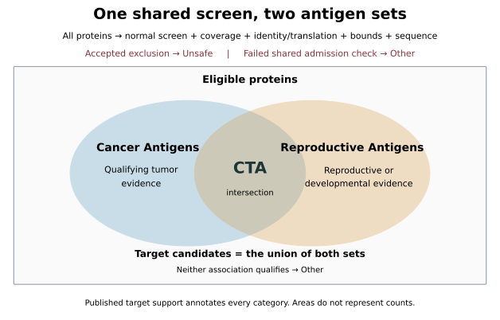
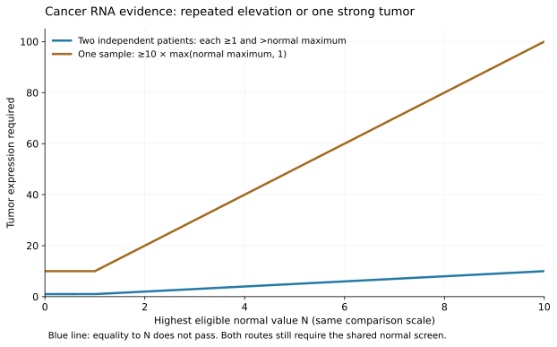

# Cancer and Reproductive Antigens

**Cancer/Testis Antigens are the intersection of Cancer Antigens and Reproductive
Antigens. Both sets use the same normal-tissue, coverage, translation and sequence
requirements. Their union is called Target candidates.**

The catalog is built under `oncoref.target-selection.2026-11-10.1`:
**641 CTA, 248 Cancer Antigen only, 31 Reproductive Antigen only, 753 Other and
18,220 Unsafe**. That gives 889 Cancer Antigens, 672 Reproductive Antigens and
920 Target candidates. [Curation funnel, filters and every change](audits/target-selection-20261110/rebuild/index.md) ·
[Browse every protein](audits/target-selection-20261110/rebuild/report.html).
The [1.36.0 catalog](cta-selection.md) retains its earlier counts and sequence
downloads as a separate versioned snapshot. The counts describe rule matches, not
experimentally validated tumor antigens.

[Illustrated rules](audits/target-selection-20261110/report.html) ·
[Machine-readable definition](audits/target-selection-20261110/definition.json) ·
[Donor-level rare-cell evidence](audits/normal-cell-atlas-20261110/rare-cell/index.md) ·
[Literature review](audits/target-selection-20261110/rebuild/literature.md)



## What changed from the 2026-11-09 draft

| Filter | Draft | Final |
|---|---|---|
| One-tumor cancer route | T ≥ 5 × max(N, 1) | T ≥ 10 × max(N, 1) |
| Target maximum | Not applied | Highest tumor, reproductive or developmental value above every measured nonreproductive and Disposable value |
| Disposable cap | Not applied | At most 32 TPM and 32 nTPM, each on its own scale |
| Rare normal-cell RNA | ≥1% detection pooled across donors, studies and ages → Unsafe | Per adult donor; multi-molecule cells only; replication across studies; mapping risk; bulk confirmation. Established or dismissed, never held for review |
| Published normal expression | Reviewed case by case | Fixed rubric applied to every candidate with a dismissed or released rare-cell signal |
| Sequence containment | Against the released Unsafe set | Recomputed against the new Unsafe set |

The draft and the analyses behind these choices stay available as dated audits:
[threshold comparison](audits/target-selection-20261109/thresholds/index.md),
[patient identities and named placements](audits/target-selection-20261109/policy-reference/index.md),
[published targets and normal peaks](audits/target-selection-20261109/category-profiles/index.md),
[expression maxima and Disposable caps](audits/target-selection-20261109/expression-maxima/index.md),
[250-protein scrutiny](audits/target-selection-20261109/scrutiny/index.md) and the
[draft catalog](audits/target-selection-20261109/rebuild/index.md). Their counts
describe the draft.

**Still open before release:** tumor-source comparability, read-level confirmation
of the mapping-risk flags, and the hair-follicle normal-protein replay.

## One shared eligibility screen

Every protein is assessed, including proteins without a published target nomination
or a qualifying translation. **An accepted normal-tissue or applicable clinical
exclusion establishes Unsafe.** Missing or conflicting evidence does not.

| Check | Requirement | Failure |
|---|---|---|
| Normal expression | Pass all applicable bulk, cell, immune, rare-cell, protein and reviewed-knowledge rules | Unsafe for accepted exclusions; otherwise Other:Review |
| Required coverage | Complete combined normal bulk panel for every member locus; retain observed findings from supplemental panels | Other:Review |
| Identity and translation | Qualifying coding reference or supported noncanonical ORF; complete approved representative; resolve conflicting coding evidence | Other:Review |
| Expression bounds | Target maximum above every measured nonreproductive and Disposable value; Disposable expression at most 32 TPM and 32 nTPM | Other:Expression |
| Sequence | Resolve nested proteins independently; fewer than 95% of 9-mers contained in Unsafe proteins | Other:Sequence |

The [tissue and cell registry](tissue-hazards.md) and
[released normal-expression rules](cta-selection.md#uniform-human-rules) supply
the normal screen. The RNA bases of 4, 8 and 16 are screening cutoffs for Vital,
Protected and Manageable contexts. The existing IHC-dependent adjustments remain
versioned screening conventions; negative staining does not demonstrate a precise
increase in tolerable RNA or a measured injury threshold.

Both antigen sets use the **same defined reproductive and Disposable allowances**.
Expression in a Disposable compartment can coexist with either membership.
Immune cells, blood vessels and other protected cells inside a reproductive organ
retain their own cell-specific assessment. An organ label does not exempt them.

**Expression bounds.** Cancer or reproductive/developmental expression must exceed
every measured nonreproductive value, including Disposable tissues, and Disposable
expression must stay at or below 32 TPM and 32 nTPM. The two caps are separate
source scales, not a unit conversion, and continue the 4/8/16/32 ordering of
tier ceilings as a screening convention. The native-TPM Disposable panel contains
appendix, gallbladder and tonsil, with no isolated hair-follicle measurements.
Both checks currently remove no candidate. [Audit](audits/target-selection-20261109/expression-maxima/index.md).

### Rare normal-cell RNA

Pooled panels average away rare cells, so each adult donor is assessed separately
in each named Vital or Protected cell population of brain, spinal cord, heart and
selected lung populations. **A count matrix cannot show where a read aligned.** One
mis-assigned read per cell, from a paralog, a pseudogene or an overlapping gene,
looks exactly like sparse expression. The grade therefore asks four questions.

| Question | Requirement |
|---|---|
| Is there a signal? | At least 1% of a donor's cells, and at least ten, carry two or more molecules. Cells with one molecule never change a category. Protected populations need twice the frequency. |
| Is it replicated? | The signal appears in two or more independent studies of the same organ. Donors of one study share its libraries and reference. Without replication, only a signal in at least 5% of a donor's cells counts. |
| Could the reads belong elsewhere? | The gene shares at least 10% of its transcript 31-mers, or of its 3′ kilobase, with another locus, or has an exon inside another same-strand gene. |
| Does another assay agree? | Bulk RNA of at least 1 TPM in the same organ in both the HPA and GTEx sample sets. |
| Is it published? | A reviewed paper reports the gene in the same organ by a gene-specific assay. |

Every signal ends in one of two outcomes. Nothing is held for review.

| Outcome | Rule | Effect |
|---|---|---|
| Established | A replicated signal at a locus without mapping risk; or any signal that bulk RNA confirms; or 1% detection in an organ where a gene-specific assay is published | Unsafe |
| Dismissed | A signal at a flagged locus, or from one study, that neither bulk RNA nor a publication confirms | None; the counts and reason stay in the record |
| Below the screen | No replicated or frequent multi-molecule signal | None |

Below the screen is not evidence of absence or safety, and no cutoff is a measured
toxicity threshold. Detection at 1%, 2% and 5% stays in the evidence tables as a
comparison. The mapping flags are properties of the reference, not checks of the
reads themselves.

Of the 1,804 graded proteins, 107 are established, 193 dismissed and 1,468 below
the screen; 36 have no measured gene. 49 draft proteins become Unsafe, including
ADAM7, CBY3, ERICH6, TOPAZ1 and WNT8A. PLAC1 stays Unsafe: its signal is replicated
in four studies at a locus with no mapping risk. TMEM269, TAS2R1 and HHLA1 carry
dismissed signals and stay candidates. PRAME, MAGE-A4, CTAG2, NUTM1 and SSX2 stay CTA.

### Published normal expression

A dismissal or a release from the old pooled flag leaves a protein's candidacy
resting on the absence of evidence, so each such protein is taken through a
literature review with a fixed rubric. 75 proteins were reviewed.

| Rule | Requirement | Effect |
|---|---|---|
| R1 | A primary source reports the gene in a panel organ by a gene-specific assay, and donor-level data detect it there | Rare-cell grade becomes established |
| R2 | A primary source reports the gene by a gene-specific assay in normal adult Vital or Protected tissue, uncontradicted by a gene-specific panel or reliable IHC | Unsafe |
| R3 | Human loss of function causes disease of a Vital tissue, and the ortholog is expressed in that adult tissue | Unsafe |

Eight are Unsafe on published evidence: MAGEA12 (brain RNA by sequenced qRT-PCR, with
our own detection; a later in situ study disputes it), AMBN and BTNL2 (gut),
GDF9 (bone marrow, pituitary), SLC25A2 (liver), ITIH6 (kidney), MYH13 (extraocular
and laryngeal muscle) and OTOG (inner ear). Several rest on one report or on an
abstract; the rubric excludes on that, and the limits are recorded with each item.

**41 proteins that were Unsafe only through the pooled 1% flag are candidates
again, including CSAG1, PABPC3 and NKX2-6.** None has a gene-specific report of
expression in vital normal tissue. That is the result of one search, not proof of
absence. NKX2-6 is the closest call: one study shows it in over a third of a
donor's cardiomyocytes, with no second study, bulk confirmation or publication.
[Every protein, source and quote](audits/target-selection-20261110/rebuild/literature.md) ·
[all changes](audits/target-selection-20261110/rebuild/changes-from-draft.csv).

Reference selection remains [MANE Select first, Ensembl canonical second, with
completeness checks and reviewed exceptions](audits/cta-transcript-selection-20261108/index.md).
An annotated coding reference can qualify without experimental protein detection.
RNA, endogenous protein, surface localization and peptide–HLA presentation remain
separate evidence fields.

## Cancer evidence

For a protein, let **N** be the highest supported measurement in a declared,
compatible healthy-tissue/cell panel, excluding the specifically allowed
reproductive and Disposable compartments. Let **T** be its value in a qualified
tumor sample. RNA qualifies through either route:

1. **Repeated expression:** at least two independent patients each have
   `T ≥ 1` and `T > N`.
2. **One strongly enriched tumor:** at least one sample has
   `T ≥ 10 × max(N, 1)`.

The values use the panel's declared native TPM, nTPM or pTPM scale. The second
route therefore requires at least 10 units when N is below 1. The floor prevents
trace expression from qualifying against a zero normal measurement. Equality to
N does not pass the repeated route; equality to the tenfold threshold passes
the single-tumor route. Two samples from the same patient count once.

| Highest eligible normal value | Two independent tumors | One tumor |
|---:|---|---|
| 0 | Each ≥1 | ≥10 |
| 0.4 | Each ≥1 | ≥10 |
| 1 | Each >1 | ≥10 |
| 3 | Each >3 | ≥30 |
| 8 | Each >8 | ≥80 |

These are selection conventions. Passing either route still requires the shared
eligibility screen. A tumor at 100 does not cancel an exclusion from normal cells
at 20. The two-tumor route can pass with a small difference above N; it establishes
repeated elevation, not a large fold change or statistical significance.



The [threshold comparison](audits/target-selection-20261109/thresholds/index.md)
tested 516 combinations of abundance, enrichment, percentile and cap rules. Moving
the one-tumor route from fivefold to tenfold kept 431 of 432 published cancer
nominations in the draft and reduced the proteins that depend on their single
largest sample from 45 to 35.

**Use compatible measurements.** A comparison records its source versions,
quantification and normalization methods, context panel and sample identities.
Matching unit names alone are insufficient: processing differences can confound
TCGA/GTEx comparisons. [Wang et al., 2018](https://pmc.ncbi.nlm.nih.gov/articles/PMC5903355/).
TPM, HPA nTPM, pTPM and single-cell CP10K are not pooled into one maximum.
Incompatible supplemental panels still enforce their own normal-exclusion rules.

N is the maximum of the declared panel's observations, with the source statistic
retained. A maximum across tissue means is not a maximum across individual
healthy donors. Missing required contexts leave the comparison unassessed;
missing values never become zero. This evaluator does not replace a required
panel with a convenient subset. Quality failures and unresolved paralog or
proteoform attribution cannot supply qualifying tumor observations.

Reviewed reliable tumor protein remains a separate positive cancer-evidence route,
with exact identity, reagent or peptide scope and source citations. Qualitative
IHC is not converted to an RNA fold change.

## Reproductive and developmental evidence

Reproductive Antigens include **adult reproductive, placental, extraembryonic,
embryonic and fetal** associations. Keep the named branch, stage, donor support and
source next to each assignment.

RNA association uses a detection floor of **1 native TPM/nTPM**, with existing
support requirements: reproductive cell clusters need at least 20 reads;
developmental lineage means need at least 20 cells, five positive cells and 10%
positive cells, with positivity measured at ≥1 TPM. Reliable mapped reproductive
IHC or reviewed human reproductive protein can also establish association.
HPA uses 1 nTPM for detection; OncoRef's application to other declared assays is
a policy choice. [HPA v23 methods](https://v23.proteinatlas.org/about/assays%2Bannotation).

**Reproductive concentration is descriptive, not an admission gate.** The old HPA
score compares adult/placental expression with adult normal tissues. It did not
measure embryonic/fetal concentration. Removing its veto gives both routes the
same admission logic; the score, source panel and missing developmental comparison
remain visible.

## Final categories

After the shared screen, cancer and reproductive evidence are assessed independently.

| Cancer evidence qualifies | Reproductive evidence qualifies | Display category |
|---|---|---|
| Yes | Yes | **CTA** |
| Yes | No qualifying evidence recorded | **Cancer Antigen only** |
| No qualifying evidence recorded | Yes | **Reproductive Antigen only** |
| No | No | **Other:Expression** |

An unassessed association remains marked unassessed. It does not erase a qualified
membership in the other set. If neither route qualifies and a route is unassessed,
the result is Other:Review. Missing required normal coverage blocks both sets.
Accepted exclusions take precedence over every positive association.

“Only” describes set membership. It does not claim that the protein is absent
from all reproductive tissues or all cancers. **Target candidates = Cancer
Antigens ∪ Reproductive Antigens**; the name does not assert clinical safety.
Disposable-only proteins and proteins low everywhere remain Other unless one of
the two positive association routes also qualifies.

## Published target support and paper claims

A curated published target nomination is **additional supporting evidence** and a
filterable subset within each antigen set. Publication is not required for membership,
and cannot override Unsafe evidence or an unresolved admission requirement.

Keep each protein–paper link, including links attached to Other and Unsafe proteins.
For each occurrence retain the citation and URL, exact mapped loci or proteoform,
table/figure when available, claim, experimental system and attribution limits.

| Paper role | What it contributes |
|---|---|
| Catalog or explicit target nomination | Prior nomination as a possible cancer, CTA or oncofetal target |
| Reproductive/developmental biology | Positive association with a tissue, cell program or stage |
| Tumor expression | Tumor RNA or protein evidence in the reported samples |
| Protein identity and translation | Evidence for or against the proposed protein or proteoform |
| Immune recognition or therapeutic study | The tested antigen, receptor/product, model or trial |
| Normal-tissue evidence | Normal production, physiological function or counterevidence |
| Background screen or reused program | Measured/program membership; not an individual target nomination |

The **core paper set** covers the curated catalog efficiently. **Supplementary
papers** retain independent experiments, specificity, normal-tissue findings and
other evidence even when their gene lists overlap the core. Overlapping lists do
not constitute independent experimental replication.

`cta_literature.attestations()` joins all retained occurrences to their citations
and original claim records. `published_nomination` identifies curated catalog
nominations; source-wide roles do not turn every gene in a paper into a target.
`publication_claims` retains exact table tags, files, sheets and rows;
`nomination_gene_ids` identifies the supported member loci. For example, da Silva's
testis-biased background and tumor proteomics tables remain separate from its
745-gene tumor-positive catalog. The source DOI alone cannot establish nomination.
Individual target experiments remain visible in their reviewed links and roles.
`current_coverage()` reports broader paper coverage, which also includes biological
and adverse evidence. A paper-covered protein is not necessarily a published target.

## Rebuilt catalog and API

```python
from oncoref import target_selection, cta_literature

contract = target_selection.definition()
counts = target_selection.metadata()["summary"]
catalog = target_selection.results()
changes = target_selection.results(changed_only=True)
cancer_only = target_selection.results(category="Cancer Antigen only")
h2bw2 = target_selection.results("H2BW2")
links = cta_literature.attestations("ENSG00000183128")
# target_selection.assess_cancer_rna(tumors, normals, ...) returns a cited receipt.
# target_selection.classify(assessed_facts) returns both memberships and one category.
# target_selection.assess_rare_cell_rna(donor_rows, mapping_risk=..., confirmed_tissues=...)
# grades one gene; results() carries rare_cell_status and the reason a signal is unresolved.
```

The new evaluator accepts evidence assessed under this contract. Legacy cancer
`>0` flags and reproductive `≥5` flags cannot substitute for the new checks.
The rebuild replays accepted normal-evidence curation, recomputes association at
1 unit, resolves tumor locus identities and counts confirmed independent patients.
All 967 proteins passing the prior shared checks have complete native-TPM comparison
coverage across the required 36 nonreproductive anatomy contexts. The normal
reference also includes measured brain subregions and immune-cell summaries.
The 130 included tumor cohort views are deduplicated by physical sample and known
participant identifiers.

These are source-native gene TPM comparisons, without cross-study batch correction.
N is the maximum of supported context summaries: tissue means, GTEx donor medians
and supported immune statistics. It is not the maximum across all healthy donors.
The stored three-sample NUTM matrix fails the nonnegative-TPM check and is excluded.
[Comparison methods](audits/target-selection-20261110/rebuild/comparison.json) ·
[Cohort coverage](audits/target-selection-20261110/rebuild/tumor-source-coverage.csv) ·
[Input hashes](audits/target-selection-20261110/rebuild/inputs.json).

The new `target_selection.results()` includes selected transcript IDs, sequence
hashes, measurements and linked paper records. `cta_selection.results()` and
sequence downloads retain the 1.36.0 snapshot and its policy identity; the new
catalog does not silently change those assets.

The [normal-cell reassessment](audits/normal-cell-atlas-20261110/index.md) records
the source inventory and the first cerebellum comparison that motivated the
rare-cell rule; it predates the donor-level grading and changes no category itself.
The [PLAC1 brain audit](audits/plac1-brain-20261110/index.md) retains the PCR, atlas
and IHC evidence for that protein.
