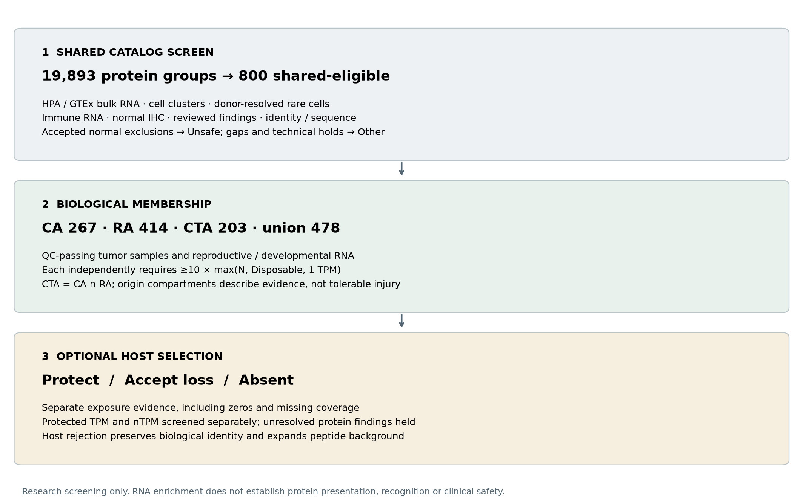
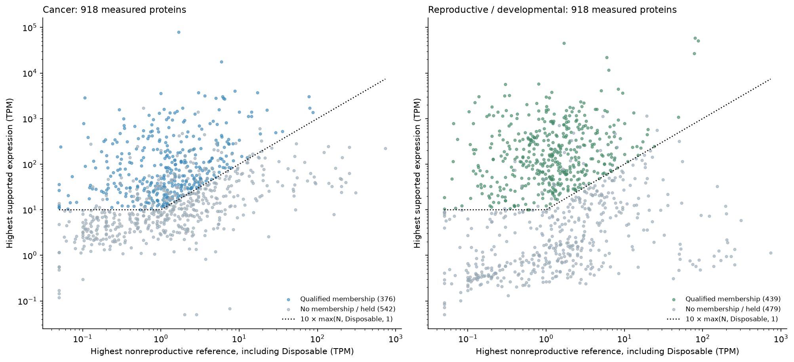
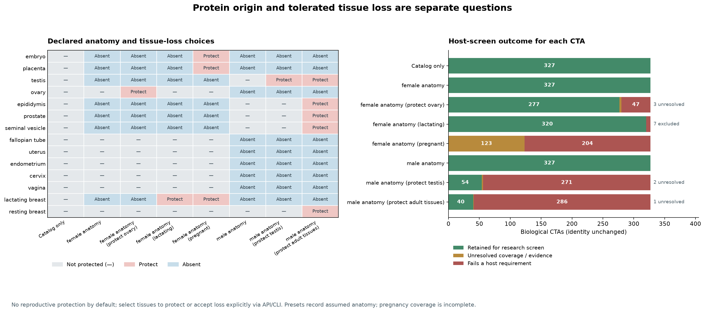

# Cancer and Reproductive Antigens

**CTA = CA ∩ RA. Candidate antigen proteins = CA ∪ RA.** Cancer-only proteins remain
Cancer Antigens; calling them CTAs would erase the reproductive distinction.

Policy `oncoref.target-selection.2026-11-17.1`: **290 CTA** · **106 Cancer Antigen only** · **113 Reproductive Antigen only** · **1,131 Other** · **18,253 Unsafe**.
These are research screening memberships, not demonstrated antigen presentation or safety.

[Browse every protein](audits/target-selection-20261110/rebuild/report.html) ·
[Funnel, Venn plots and counts](audits/target-selection-20261110/rebuild/summary.md) ·
[Host profiles & optional filters](target-filters.md) ·
[Machine-readable rules](audits/target-selection-20261110/definition.json)

## Three sequential questions

OncoRef classifies every human protein group (**19,893** groups from **20,099** Ensembl 115
coding loci) by asking three independent, sequential questions:

1. **Shared somatic safety:** Is the protein safe across shared human vital, protected,
   immune, and disposable organs, with complete 36-tissue coverage, approved translation,
   resolved sequence identity, and bounded Disposable expression? (**18,253** `Unsafe`;
   **779** `Other:Review` / `Other:Sequence`; **15** bounds failures → **846** shared-eligible.)
2. **Symmetric 10× compartment enrichment:** Against the shared somatic baseline
   **H₀ = max(Normal N, Disposable D, 1 TPM)**, does expression reach **≥ 10 × H₀** in
   QC-passing tumors (**CA = 396**) and/or
   reproductive-developmental compartments (**RA = 403**)?
   Their intersection is the default broad **CTA (290)** set.
3. **Host anatomy & toxicity tolerance (optional profile slice):** Which of the **12**
   conditional reproductive, developmental, and mammary compartments exist in a specific
   patient and are *not* tolerated for toxicity? Selecting a patient profile (`male-patient`,
   `female-patient`, `--lactating`, `--pregnant`, `core`, or custom `--allow-tissue` /
   `--protect-tissue`) moves protected host compartments into the off-target denominator.



## One threshold, two compartments

Let **H₀ = max(N, D, 1 TPM)**: N is the highest supported non-reproductive normal
measurement and D the highest Disposable-tissue measurement (`appendix`, `gallbladder`, `tonsil`).
Both sets require **at least 10 × H₀**, independently, after the same eligibility screen.

| Set | Required positive RNA evidence |
|---|---|
| CA | At least one QC-passing tumor sample ≥10 × H₀ (and not an unmeasured home tissue without RA) |
| RA | At least one reproductive tissue sample, or supported embryo-specific lineage mean, ≥10 × H₀ |
| CTA | Both CA and RA (**290** proteins in default `all` mode) |
| CA∪RA | Either set (**509** candidate proteins; RA-only does not imply tumor expression) |

All comparisons use the declared native-TPM panel. Qualitative protein staining,
single-cell nTPM and UMI counts cannot be divided by TPM or bypass its numerical fold.
Reproductive IHC and older association routes remain visible as supporting annotations.

The normal reference includes **individual HPA v23 tissue samples from all measured
compartments**, plus tissue/subregion means, GTEx v11 donor medians and supported immune
summaries. Reproductive observations are positive candidates; non-reproductive
observations tighten the denominator. Missing required normal coverage never becomes zero.
[Source receipt and limits](audits/target-selection-20261110/rebuild/comparison.json).

Developmental means are computed within one embryo and lineage. One well-sampled
population requires ≥20 cells, ≥5 cells with ≥1 TPM and ≥10% positive cells.
Smaller populations require ≥5 measured cells, ≥50% with ≥1 TPM, and two independent
embryos at the same age and lineage reaching 10 × H₀. Embryos are biological donors;
multiple cells or lineages from one embryo are not independent donors.



## CTA tiers, lactating mammary, and patient toxicity profiles

The default `CTA` set (**290** proteins) intentionally spans **all 12**
reproductive, developmental, and mammary compartments so no sex-specific or surgical
target is discarded upstream. Those 12 compartments divide into four biological groups:

- **Core germline & fetoplacental (`4`):** `embryo`, `placenta`, `testis`, `ovary`
- **Male accessory organs (`3`):** `epididymis`, `prostate`, `seminal vesicle`
  (anatomically absent in XX females; vascularized MHC-I+ organs in intact XY males)
- **Female Müllerian tract (`3`):** `fallopian tube`, `endometrium`, `cervix`
  (anatomically absent in XY males; vascularized MHC-I+ organs in intact XX females)
- **Mammary physiological states (`2`):** `lactating_breast` vs `resting_breast`

### Why `lactating_breast` is distinct from `resting_breast`

Men possess rudimentary mammary ductal epithelium (which expresses constitutive ductal
genes and can undergo gynecomastia), so **resting mammary tissue is protected in both
sexes**. By contrast, secretory milk-protein transcription requires lactogenic hormonal
differentiation: in HPA v23, biopsy `breast.410` expresses coordinated milk proteins at
massive levels (`LALBA` 9,523 TPM, `CSN1S1` 6,058 TPM, `CSN2` 2,530 TPM, `CSN3` 1,582 TPM,
`BTN1A1` 140 TPM), whereas all resting breast biopsies (`breast.373`, `breast.390`,
`breast.405`) are near zero (`LALBA` ≤ 0.5 TPM, `BTN1A1` ≤ 0.2 TPM). Separating
`lactating_breast` (`≥ 3` of `LALBA, CSN1S1, CSN2, CSN3` at `≥ 100 TPM`) from
`resting_breast` keeps `LALBA` and `BTN1A1` available for non-lactating female and male
patients while immediately excluding them when `lactating=True`.

### Three biological CTA tiers (`cta_tier`)

Every CTA row carries an explicit `cta_tier` decomposition (`257 + 9 + 24 = 290`):

- **`core` (257 CTAs):** Qualifies in `embryo`, `placenta`, `testis`, or `ovary`,
  and every one of the 8 extended adult compartments is ≤ 32 TPM and ≥ 10× below peak tumor
  expression (e.g., `MAGEA4`, `NY-ESO-1`, `PRAME`, `SSX2/B`, `MAGEC2`).
- **`core_with_extended_exposure` (9 CTAs):** Qualifies
  in a Core compartment, but also exceeds 32 TPM or lacks a 10× tumor margin in an adult
  accessory, tract, or resting-breast sample (e.g., `MAGEA11`, `MAGEB4`, `RNASE11`,
  `KIAA1210`, `ADAM2`, `TCP11X2`).
- **`extended_only` (24 CTAs):** Qualifies only via extended compartments —
  21 male-organ antigens (`TGM4`, `RLN1`, `SEMG2`, `POTEH`, `SPAG11A/B`, `PATE1`, ...),
  2 lactation antigens (`LALBA`, `BTN1A1`), and 1 shared tract antigen (`SCGB1D4`).

### Selecting which compartments are protected in a patient

Every host profile is defined by **one set P of protected compartments** (tissues present
in the patient where toxicity is *not* accepted):

1. Every compartment in **P** must stay **≤ 32 TPM** (`DISPOSABLE_CAP`),
2. Tumor expression must reach **≥ 10 × max(H₀, max_P TPM)**, and
3. `RA` must qualify (**≥ 10 × H₀**) in at least one **allowed** compartment outside **P**.



| Profile | Protected compartments (**P**) | CTA | CA only | RA only | CA∪RA |
|---|---|---:|---:|---:|---:|
| `all` | none | **290** | 106 | 113 | 509 |
| `female-patient` | fallopian tube, endometrium, cervix, resting_breast | **285** | 105 | 117 | 507 |
| `female-patient (lactating)` | fallopian tube, endometrium, cervix, lactating_breast, resting_breast | **283** | 105 | 115 | 503 |
| `female-patient (pregnant)` | embryo, placenta, fallopian tube, endometrium, cervix, resting_breast | **129** | 89 | 117 | 335 |
| `male-patient` | epididymis, prostate, seminal vesicle, resting_breast | **260** | 104 | 103 | 467 |
| `male-patient (post-prostatectomy)` | epididymis, resting_breast | **264** | 105 | 103 | 472 |
| `core` | epididymis, prostate, seminal vesicle, fallopian tube, endometrium, cervix, lactating_breast, resting_breast | **257** | 103 | 102 | 462 |

Callers can toggle individual tissues directly (e.g., `allow_tissues=("prostate", "seminal vesicle")`
after radical prostatectomy, `allow_tissues=("breast",)` after bilateral mastectomy, or
`protect_tissues=("testis",)` / `protect_tissues=("ovary",)` for fertility/endocrine preservation).

## Shared eligibility and Other

| Layer | Consequence |
|---|---|
| Accepted normal RNA, normal protein or applicable clinical exclusion | Unsafe |
| Missing coverage, uncertain identity/translation or unresolved normal evidence | Other:Review |
| Unsupported nested protein, ≥95% Unsafe 9-mer containment or read-through locus | Other:Sequence |
| Unmeasured normal home without qualifying reproductive evidence | Other:Tissue |
| Neither enrichment compartment qualifies, or expression bounds fail | Other:Expression |

Unsafe takes precedence. Other:Review then precedes the other Other subtypes.
Every failed check remains on the row, even when another determines its category.
**Other is neither an accepted hazard nor a claim of absent normal expression.**

Disposable expression retains separate ceilings of 32 native TPM and 32 nTPM.
The target maximum must exceed all measured non-reproductive contexts. Tissue
allowances apply to resolved cell compartments: immune or vascular cells inside a
reproductive organ do not automatically inherit that organ's allowance.

## Consequences of tissue loss

Reproductive membership and the consequences of losing the expressing tissue are
separate questions. The [tissue registry](tissue-tiers.md) records **acute loss, lasting
loss, repair and management**. Whole testis and ovary retain Protected assessments
(reflecting Leydig/endocrine and germ-cell loss in bulk measurements); mammary tissue has
a conditional Manageable assessment. Bulk organ measurements do not establish which cell
population expresses a protein or whether only that population would be injured.

```python
from oncoref import antigen_sets, tissue_tiers

loss = tissue_tiers.consequences("testis")
antigen_sets.loss_consequences("LALBA")  # shows breast (lactating_breast): 9523.2 TPM
```

## Rare normal-cell RNA

Single-cell and single-nucleus data are independent normal-expression layers.
They can identify a normal population diluted in bulk tissue. The donor-resolved
UMI rubric is distinct from HPA cell-cluster nTPM and bulk TPM.

| Check | Rule |
|---|---|
| Signal | >= 1% of a donor's cells and >= 10 cells carry >= 2 molecules. Protected populations need 2 times these frequencies. |
| Replication | The signal in >= 2 independent studies of the same organ, which agree on a cell type or include >= 3 donors. Donors of one study share its libraries and reference; one donor in each of two studies, in different cell types, agrees on nothing but the organ. |
| Frequent single-study signal | Without replication, a signal counts only when >= 5% of a donor's cells carry multiple molecules. |
| Orthogonal confirmation | Bulk RNA >= 1 native TPM in the same organ in both the HPA and GTEx sample sets, a different assay with its own read assignment. |
| Established | A replicated signal at a locus without mapping risk, or any signal with bulk confirmation. Unsafe. |
| Unresolved | A replicated signal with unresolved locus attribution, or a frequent single-study signal without independent confirmation. Other:Review pending adjudication. |
| Dismissed | A weak or inconsistent signal below replication and frequency requirements. Recorded with its reason; no category effect. |

A reference mapping-risk flag does not show where the observed reads aligned.
DCST1's replicated retinal signal and NKX2-6's frequent single-study cardiac signal
therefore require review, rather than being dismissed as artifacts. Single molecules alone
do not establish expression; reviewed gene-specific evidence can provide independent
confirmation. [Donor records, grades and reasons](audits/normal-cell-atlas-20261110/rare-cell/index.md).

## Protein staining

Reliable, identity-resolved normal protein findings can independently mark a protein
Unsafe under the tissue-tier policy. Antibody specificity, staining reliability,
cell type and source scope remain part of each finding.

## Published normal expression

Reviewed publications are adjudicated through the shared evidence records: accepted
gene-specific normal expression in Vital or Protected tissues excludes; other
observations retain their tissue, scope and rationale.
[Literature rubric and sources](audits/target-selection-20261110/rebuild/literature.md).

## Home tissue the panels do not resolve

Olfactory epithelium, nasal mucosa, taste buds, hair follicle and dental pulp are not
resolved by the comparison panel. A recorded home in one of these tissues yields
Other:Tissue unless reproductive evidence qualifies. The home remains recorded
even when RA qualifies; a candidate label does not establish a measured margin there.

## Tumor quality and replication

Passing TGCT libraries contribute normally. The shared QC screen excludes libraries
with broad olfactory-receptor background, a coordinated late-spermatid signature,
or multiple unrelated tissue signatures.
[Every library measurement](audits/target-selection-20261110/rebuild/library-qc.csv.gz).

Catalog rows expose `samples_at_tenfold`, `independent_patients_at_tenfold`,
`anonymous_samples_at_tenfold` and `cancer_types_at_tenfold`. Unknown donors never
count as known independent patients. `independent_patient_tumor_folds` stores each
qualifying known patient's maximum fold in descending order.

## API, host profiles, and peptide subtraction

```python
from oncoref import antigen_sets, target_filters, target_selection

all_ctas = antigen_sets.proteins("CTA")                              # 290 default CTAs
core_ctas = antigen_sets.proteins("CTA", profile="core")             # 257 Core CTAs
male_ctas = antigen_sets.proteins("CTA", profile="male-patient")     # 260 CTAs (includes LALBA)
female_ctas = antigen_sets.proteins("CTA", profile="female-patient") # 285 CTAs (includes TGM4, LALBA)
lactating_safe = antigen_sets.proteins(
    "CTA", profile="female-patient", lactating=True                  # 283 CTAs (excludes LALBA, BTN1A1)
)
post_rp = antigen_sets.proteins(
    "CTA", profile="male-patient", allow_tissues=("prostate", "seminal vesicle")
)
background = antigen_sets.proteins("Unsafe|Other")
record = target_selection.results("LALBA")
```

All annotated translations can feed exact 8–15mer or optional bounded-distance
subtraction, with occurrences and sequence gaps retained.
[Sequence API](antigen-sequences.md) · [Optional filters & host profiles](target-filters.md) ·
[CLI & curation build](curation.md).

## Reproduction and review status

The [rebuild](audits/target-selection-20261110/rebuild/index.md) publishes inputs,
receipts, every assignment and both sequential and sole-reason attribution.
`release_ready: false` describes outstanding scientific adjudications, including
read-level mapping review and the hair-follicle replay (#687). Open holds stay excluded
from positive sets. Historical catalogs remain dated snapshots.
