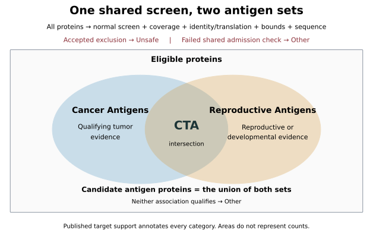
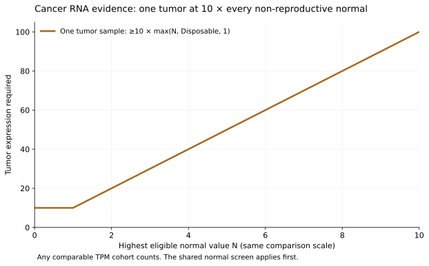

# Cancer and Reproductive Antigens

**Cancer/Testis Antigens are the intersection of Cancer Antigens and Reproductive
Antigens. Both sets use the same normal-tissue, coverage, translation and sequence
requirements. Their union is called candidate antigen proteins (the `is_target_candidate` API flag).**

The catalog is built under `oncoref.target-selection.2026-11-16.1`:
**437 CTA, 34 Cancer Antigen only, 197 Reproductive Antigen only, 972 Other and
18,253 Unsafe**. That gives 471 Cancer Antigens, 634 Reproductive Antigens and
668 candidate antigen proteins. [Curation funnel, filters and every change](audits/target-selection-20261110/rebuild/index.md) ·
[Browse every protein](audits/target-selection-20261110/rebuild/report.html).
The [1.36.0 catalog](cta-selection.md) retains its earlier counts and sequence
downloads as a separate versioned snapshot. The counts describe rule matches, not
experimentally validated tumor antigens.

[Illustrated rules](audits/target-selection-20261110/report.html) ·
[Machine-readable definition](audits/target-selection-20261110/definition.json) ·
[Donor-level rare-cell evidence](audits/normal-cell-atlas-20261110/rare-cell/index.md) ·
[Literature review](audits/target-selection-20261110/rebuild/literature.md)



## What changed on 2026-11-16

TGCT libraries that pass sample QC now supply cancer evidence. The shared library
screen flags seven TGCT libraries with all six late-spermatid markers at ≥0.1% of
their GTEx testis medians, and one Hodgkin library with >20% of measured olfactory
receptors at ≥5 TPM. Four unrelated tissue programs at ≥0.3% also trigger the screen;
no additional library meets that rule. These are conservative signatures, not
proof of contamination or calibrated tissue fractions. Every measurement and
reason is preserved in the [library QC table](audits/target-selection-20261110/rebuild/library-qc.csv.gz).

DAZL, PRDM14, ZNF705D, TMEM202 and GOLGA6D gain CTA membership through passing TGCT
libraries. MAGEC2 becomes CTA (681.6×) after the reviewed HPA062230/GTEx adjudication
supersedes the historical TC-1 hold. The MAGE family filter remains independent.
Removing the Hodgkin library removes cancer support from 22 prior CTAs and three
cancer-only proteins. The 22 remain reproductive antigens. DAZ1–4 remain excluded
from candidates; the shared findings preserve their gastric RNA and sequence rationale.

The tenfold denominator is the highest supported **normal context summary**, not
the maximum over every healthy donor. Native TPM comparisons retain study and
quantifier effects; the floor is 10 TPM when all non-reproductive summaries are
below 1 TPM. Normal RNA/protein and rare-cell exclusions still apply independently.

[Current release](cta-release-1.39.0.md) · [Set and peptide APIs](antigen-sequences.md)

The sections below retain the chronology of earlier policy revisions.

## What changed on 2026-11-15

**One cancer rule.** A Cancer Antigen needs one tumor sample at 10 times every
non-reproductive normal value, from any comparable TPM cohort except germ cell tumors.

| Rule | Before | Now |
|---|---|---|
| Cancer evidence | Two independent patients above N, or one tumor at 10 × max(N, 1) | One tumor at 10 × max(N, Disposable, 1). Patients above N are reported and admit nothing |
| Germ cell tumors | Counted as cancer samples | Not cancer evidence: their germline program is lineage, not activation |
| Home tissue the panels do not resolve | New on 2026-11-14 | Other:Tissue unless reproductive evidence qualifies; every family rule names a home |
| Olfactory epithelium | Protected | Manageable, on the oncology precedent ([tissue tiers](tissue-tiers.md#how-a-tier-is-chosen)) |
| Target candidates | 868 | 670 |

All 27 familiar CTAs that were CTAs remain CTAs; the lowest is AKAP4 at 16 times its
normal maximum. 153 CTAs become Reproductive Antigen only: for 63 no tumor sample
reaches the 10 TPM minimum, for 75 no tumor reaches ten times a measured normal value,
and 15 qualified only through germ cell tumors (DAZL, PRDM14, PGK2, PRM2 and others).
[Every CTpedia gene](ctpedia-filtering.md) and the
[tenfold rule review](audits/cta-threshold-review-20261116/index.md) show where each
protein lands and why.

## What changed on 2026-11-13

**The curation that the candidate filters used on their own is now part of the
catalog.** There is one literature review, one tissue-tier registry and one sequence check.

| Record | Before | Now |
|---|---|---|
| Literature review | 99 proteins with a dismissed or released rare-cell signal | Those and every Target candidate of the 2026-11-10 catalog: 912 proteins |
| Published normal expression | 9 proteins Unsafe by the rubric | 23. The 14 added each have a quote retrieved from the source |
| Read-through loci | Removed by a filter knob | Fail the sequence check: Other:Sequence |
| Tissue tiers | Seven tissues tiered in a filter file | Seven tissues added to the tissue-tier registry as dated updates |
| Proteins of a tissue no panel resolves | Cancer Antigen only when a tumor value cleared the measured tissues | Other:Tissue unless reproductive evidence qualifies: 178 proteins |
| Target candidates | 902 | 690 |

Candidate filters hold no evidence of their own any more. [Filter rules](target-filters.md).

## What changed from the 2026-11-09 draft

| Filter | Draft | Final |
|---|---|---|
| One-tumor cancer route | T ≥ 5 × max(N, 1) | T ≥ 10 × max(N, 1) |
| Target maximum | Not applied | Highest tumor, reproductive or developmental value above every measured nonreproductive and Disposable value |
| Disposable cap | Not applied | At most 32 TPM and 32 nTPM, each on its own scale |
| Rare normal-cell RNA | ≥1% detection pooled across donors, studies and ages → Unsafe | Per adult donor across every sampled non-reproductive tissue; multi-molecule cells only; replication across studies; mapping risk; bulk confirmation. Established or dismissed, never held for review |
| Published normal expression | Reviewed case by case | Fixed rubric applied to every candidate with a dismissed or released rare-cell signal |
| Sequence containment | Against the released Unsafe set | Recomputed against the new Unsafe set |

The draft and the analyses behind these choices stay available as dated audits:
[threshold comparison](audits/target-selection-20261109/thresholds/index.md),
[patient identities and named placements](audits/target-selection-20261109/policy-reference/index.md),
[published targets and normal peaks](audits/target-selection-20261109/category-profiles/index.md),
[expression maxima and Disposable caps](audits/target-selection-20261109/expression-maxima/index.md),
[250-protein scrutiny](audits/target-selection-20261109/scrutiny/index.md) and the
[draft catalog](audits/target-selection-20261109/rebuild/index.md). Their counts
describe the draft.

**Still open before release:** tumor-source comparability, read-level confirmation
of the mapping-risk flags, and the hair-follicle normal-protein replay.

## One shared eligibility screen

Every protein is assessed, including proteins without a published target nomination
or a qualifying translation. **An accepted normal-tissue or applicable clinical
exclusion establishes Unsafe.** Missing or conflicting evidence does not.

| Check | Requirement | Failure |
|---|---|---|
| Normal expression | Pass all applicable bulk, cell, immune, rare-cell, protein and reviewed-knowledge rules | Unsafe for accepted exclusions; otherwise Other:Review |
| Required coverage | Complete combined normal bulk panel for every member locus; retain observed findings from supplemental panels | Other:Review |
| Identity and translation | Qualifying coding reference or supported noncanonical ORF; complete approved representative; resolve conflicting coding evidence | Other:Review |
| Expression bounds | Target maximum above every measured nonreproductive and Disposable value; Disposable expression at most 32 TPM and 32 nTPM | Other:Expression |
| Sequence | Resolve nested proteins independently; fewer than 95% of 9-mers contained in Unsafe proteins; not a read-through locus | Other:Sequence |
| Home tissue | When the recorded normal home is a tissue no panel resolves, reproductive or developmental evidence must qualify | Other:Tissue |

The [tissue and cell registry](tissue-tiers.md) and
[released normal-expression rules](cta-selection.md#uniform-human-rules) supply
the normal screen. The RNA bases of 4, 8 and 16 are screening cutoffs for Vital,
Protected and Manageable contexts. The existing IHC-dependent adjustments remain
versioned screening conventions; negative staining does not demonstrate a precise
increase in tolerable RNA or a measured injury threshold.

Both antigen sets use the **same defined reproductive and Disposable allowances**.
Expression in a Disposable compartment can coexist with either membership.
Immune cells, blood vessels and other protected cells inside a reproductive organ
retain their own cell-specific assessment. An organ label does not exempt them.

**Expression bounds.** Cancer or reproductive/developmental expression must exceed
every measured nonreproductive value, including Disposable tissues, and Disposable
expression must stay at or below 32 TPM and 32 nTPM. The two caps are separate
source scales, not a unit conversion, and continue the 4/8/16/32 ordering of
tier ceilings as a screening convention. The native-TPM Disposable panel contains
appendix, gallbladder and tonsil, with no isolated hair-follicle measurements.
Both checks currently remove no candidate. [Audit](audits/target-selection-20261109/expression-maxima/index.md).

### Rare normal-cell RNA

Pooled panels average away rare cells, so each adult donor is assessed separately
in each named Vital or Protected cell population of every sampled non-reproductive
tissue: brain, eye, heart, lung, kidney, liver, pancreas, gut and others, 13.6 million
cells in all. Immune, stromal and developmental labels are left to the sorted-cell
layers, and reproductive organs are left out because germ-cell RNA contaminates
their somatic cells. **A count matrix cannot show where a read aligned.** One
mis-assigned read per cell, from a paralog, a pseudogene or an overlapping gene,
looks exactly like sparse expression. The grade therefore asks four questions.

| Question | Requirement |
|---|---|
| Is there a signal? | At least 1% of a donor's cells, and at least ten, carry two or more molecules. Cells with one molecule never change a category. Protected populations need twice the frequency. |
| Is it replicated? | The signal appears in two or more independent studies of the same organ, and the studies agree on a cell type or include at least three donors. Donors of one study share its libraries and reference. One donor in each of two studies, in different cell types, agrees on nothing but the organ. Without replication, only a signal in at least 5% of a donor's cells counts. |
| Could the reads belong elsewhere? | The gene shares at least 10% of its transcript 31-mers, or of its 3′ kilobase, with another locus, or has an exon inside another same-strand gene. |
| Does another assay agree? | Bulk RNA of at least 1 TPM in the same organ in both the HPA and GTEx sample sets. |
| Is it published? | A reviewed paper reports the gene in the same organ by a gene-specific assay. |

Every signal ends in one of two outcomes. Nothing is held for review.

| Outcome | Rule | Effect |
|---|---|---|
| Established | A replicated signal at a locus without mapping risk; or any signal that bulk RNA confirms; or 1% detection in an organ where a gene-specific assay is published | Unsafe |
| Dismissed | A signal at a flagged locus, or from one study, that neither bulk RNA nor a publication confirms | None; the counts and reason stay in the record |
| Below the screen | No replicated or frequent multi-molecule signal | None |

Below the screen is not evidence of absence or safety, and no cutoff is a measured
toxicity threshold. Detection at 1%, 2% and 5% stays in the evidence tables as a
comparison. The mapping flags are properties of the reference, not checks of the
reads themselves.

Of the 1,804 graded proteins, 129 are established, 267 dismissed and 1,372 below
the screen; 36 have no measured gene. 68 draft proteins become Unsafe, including
ADAM7, CBY3, ERICH6, TOPAZ1 and WNT8A. PLAC1 stays Unsafe: its signal is replicated
in four studies at a locus with no mapping risk. TMEM269, TAS2R1 and HHLA1 carry
dismissed signals and stay candidates. MAGE-A4, CTAG2, NUTM1 and SSX2 stay CTA.

**A dismissed signal is a warning, not an exclusion.** It stays on the protein's row
with its tissue, cell type, donors and reason, so a candidate can be chosen with the
possible toxicity in view. Exclusion is kept for signals that studies agree on, that
bulk RNA confirms or that a publication reports. PRAME shows where the line falls.
Two donors in two studies of the eye carry it in 1.2–1.5% of cells, in different
populations (melanocytes and optic-nerve oligodendrocytes). Counting that as
replication made PRAME Unsafe, although PRAME-directed T-cell therapies are given
to patients. Two lone donors in different cell types are now dismissed; EXD1 and
LRRIQ4 are released by the same change. Photoreceptor and retinal genes such as
CCDC172, SPINT4 and C7orf33 stay Unsafe on tens of donors. The largest remaining
gap is the mapping-risk dismissal: DCST1 is seen in 36% of cone cells across 73
donors and five studies, and stays a candidate because one of its exons lies inside
another gene.

### Published normal expression

**Every candidate is taken through one literature review with a fixed rubric.** The
review has 912 entries from two passes: the 99 proteins whose candidacy rested on a
dismissed or released rare-cell signal, and a 2026-11-12 sweep of every Target
candidate of the 2026-11-10 catalog.

| Rule | Requirement | Effect |
|---|---|---|
| R1 | A primary source reports the gene in a panel organ by a gene-specific assay, and donor-level data detect it there | Rare-cell grade becomes established |
| R2 | A primary source reports the gene by a gene-specific assay in normal adult tissue that the tissue-tier registry or its updates tier Vital or Protected, uncontradicted by a gene-specific panel or reliable IHC | Unsafe |
| R3 | Human loss of function causes disease of a Vital tissue, and the ortholog is expressed in that adult tissue | Unsafe |
| Recorded | A confirmed human, adult, gene-specific finding that does not meet R1 to R3 | The tissue and tier stay on the row. The only category effect is the [home-tissue rule](#home-tissue-the-panels-do-not-resolve) |

An exclusion needs a quote retrieved from the source. Twenty-three entries act.

- **From the first pass, nine:** MAGEA12 (brain RNA by sequenced qRT-PCR, with our own
  detection; a later in situ study disputes it), SCGB1D1 (sequenced from normal tears,
  with our own detection in acinar cells of the eye), AMBN and BTNL2 (gut), GDF9 (bone
  marrow, pituitary), SLC25A2 (liver), ITIH6 (kidney), MYH13 (extraocular and laryngeal
  muscle) and OTOG (inner ear).
- **From the candidate sweep, fourteen:** ADAM30, BECN2 and SRY (brain), DEFB106A/B and
  OBP2A (lung), GALR3 (adrenal gland), SULT6B1 (kidney), MRGPRX1 (sensory ganglia),
  ASCL4 and TCHHL1 (skin), CCN6 (cartilage), BPIFB3, BPIFB6 and SCGB1C1 (olfactory
  epithelium).

Several rest on one report or on an abstract; the rubric excludes on that, and the
limits are recorded with each item.

**Recorded findings and family rules do not change a category.** Eighteen proteins have
a confirmed finding in a Vital or Protected tissue that falls short of the rubric:
cultured cells, a database annotation alone, a family-level source, or no retrievable
quote. LRRC52 (skeletal muscle) and PRKACG (platelets) are the closest calls. Six family
rules name proteins by label; olfactory receptors (164 candidates) and bitter taste
receptors (8) point to Protected tissues. **Olfactory receptors were not reviewed gene
by gene**, so they stay candidates while BPIFB3, with per-gene olfactory RNA, does not.
The [candidate filters](target-filters.md) can remove recorded proteins by tier.

**41 proteins that were Unsafe only through the pooled 1% flag are candidates
again, including CSAG1, PABPC3 and NKX2-6.** None has a gene-specific report of
expression in vital normal tissue. That is the result of one search, not proof of
absence. NKX2-6 is the closest call: one study shows it in over a third of a
donor's cardiomyocytes, with no second study, bulk confirmation or publication.
[Every protein, source and quote](audits/target-selection-20261110/rebuild/literature.md) ·
[all changes](audits/target-selection-20261110/rebuild/changes-from-draft.csv).

Reference selection remains [MANE Select first, Ensembl canonical second, with
completeness checks and reviewed exceptions](audits/cta-transcript-selection-20261108/index.md).
An annotated coding reference can qualify without experimental protein detection.
RNA, endogenous protein, surface localization and peptide–HLA presentation remain
separate evidence fields.

## Cancer evidence

For a protein, let **N** be the highest supported measurement in a declared,
compatible healthy-tissue/cell panel, excluding the reproductive and Disposable
compartments, and **D** the highest Disposable value. Let **T** be its value in a
qualified tumor sample. **Cancer RNA qualifies when one tumor sample has
`T ≥ 10 × max(N, D, 1)`.** That is the only route.

- **Any comparable cohort counts:** every tumor cohort view with native gene TPM
  (130 views), one sample at a time. Patient identity is not needed.
- **Passing germ cell tumors count.** The coordinated spermatid-program screen removes
  libraries that may contain normal testis; lineage alone does not exclude a histology.
- **The floor of 1 TPM** keeps trace expression from qualifying against a zero normal
  value: a protein with N below 1 needs a tumor at 10 TPM or more.
- **Reproductive, placental and fetal tissue is never in N.** Those are the
  Reproductive Antigen route.

| Highest non-reproductive value max(N, D) | One tumor sample needs |
|---:|---|
| 0 | ≥10 |
| 0.4 | ≥10 |
| 1 | ≥10 |
| 3 | ≥30 |
| 8 | ≥80 |

`tumor_fold` on each row is the highest tumor over max(N, D, 1). Independent patients
and samples above N are still counted on each row; they admit nothing. One sample can
admit a protein: `tumor_top_sample` names it. A documented patient is not required.
The Hodgkin library SRS3811196 that previously supplied many sole witnesses is now
excluded by the broad-background check. Every excluded library and its measurements
remain in the [library QC table](audits/target-selection-20261110/rebuild/library-qc.csv.gz).
The largest remaining shared top sample and support counts are shown in the
[current filter audit](audits/target-filters-20261112/index.md).

Passing the rule still requires the shared eligibility screen. A tumor at 100 does not
cancel an exclusion from normal cells at 20.



The earlier [threshold comparison](audits/target-selection-20261109/thresholds/index.md)
tested 516 combinations of abundance, enrichment, percentile and cap rules against the
2026-11-09 draft.

**Use compatible measurements.** A comparison records its source versions,
quantification and normalization methods, context panel and sample identities.
Matching unit names alone are insufficient: processing differences can confound
TCGA/GTEx comparisons. [Wang et al., 2018](https://pmc.ncbi.nlm.nih.gov/articles/PMC5903355/).
TPM, HPA nTPM, pTPM and single-cell CP10K are not pooled into one maximum.
Incompatible supplemental panels still enforce their own normal-exclusion rules.

N is the maximum of the declared panel's observations, with the source statistic
retained. A maximum across tissue means is not a maximum across individual
healthy donors. Missing required contexts leave the comparison unassessed;
missing values never become zero. This evaluator does not replace a required
panel with a convenient subset. Quality failures and unresolved paralog or
proteoform attribution cannot supply qualifying tumor observations.

Reviewed reliable tumor protein remains a separate positive cancer-evidence route,
with exact identity, reagent or peptide scope and source citations. Qualitative
IHC is not converted to an RNA fold change.

## Home tissue the panels do not resolve

**A protein whose normal home is a tissue no expression panel resolves is a Target
candidate only with reproductive or developmental evidence. Otherwise it is
Other:Tissue.** Cancer evidence means tumor expression above every measured normal
tissue. For these proteins the one tissue that matters was never in the comparison.

| | |
|---|---|
| Tissues | Olfactory epithelium, nasal mucosa, taste bud, hair follicle, dental pulp. Nose and tooth are absent from the panels; bulk skin and tongue dilute hair follicle and taste buds |
| How a home is recorded | A family rule (olfactory, trace-amine and taste receptors, hair keratins and keratin-associated proteins), a recorded literature finding, or the [nose and skin reference](target-filters.md#normal-nose-and-skin-which-the-expression-panels-do-not-sample) |
| Without reproductive evidence | Other:Tissue: 119 proteins. 87 olfactory receptors, 20 hair keratins and keratin-associated proteins, 6 bitter taste receptors, TAS1R2, TAAR9, BPIFB3 and BPIFB6 (olfactory epithelium), DSPP and PANX3 (tooth) |
| With reproductive evidence | Category unchanged; the tissue stays on the row and the candidate filters act on its tier. 41 proteins: 26 CTA and 15 Reproductive Antigen only |

The rule does not depend on the tissue's tier, and it makes nothing Unsafe: these
proteins are tissue-specific, not shown to be dangerous. Fourteen of the 119 have a
published target nomination. PANX3 has a tumor at 1,388 TPM; it moves because its
recorded home is dental pulp. Members of these families whose best tumor is below 10x
are Other:Expression instead.

## Reproductive and developmental evidence

Reproductive Antigens include **adult reproductive, placental, extraembryonic,
embryonic and fetal** associations. Keep the named branch, stage, donor support and
source next to each assignment.

RNA association uses a detection floor of **1 native TPM/nTPM**, with existing
support requirements: reproductive cell clusters need at least 20 reads;
developmental lineage means need at least 20 cells, five positive cells and 10%
positive cells, with positivity measured at ≥1 TPM. Reliable mapped reproductive
IHC or reviewed human reproductive protein can also establish association.
HPA uses 1 nTPM for detection; OncoRef's application to other declared assays is
a policy choice. [HPA v23 methods](https://v23.proteinatlas.org/about/assays%2Bannotation).

**Reproductive concentration is descriptive, not an admission gate.** The old HPA
score compares adult/placental expression with adult normal tissues. It did not
measure embryonic/fetal concentration. Removing its veto gives both routes the
same admission logic; the score, source panel and missing developmental comparison
remain visible.

## Final categories

After the shared screen, cancer and reproductive evidence are assessed independently.

| Cancer evidence qualifies | Reproductive evidence qualifies | Display category |
|---|---|---|
| Yes | Yes | **CTA** |
| Yes | No qualifying evidence recorded | **Cancer Antigen only** |
| No qualifying evidence recorded | Yes | **Reproductive Antigen only** |
| No | No | **Other:Expression** |
| Yes, but the home tissue was never compared | No | **Other:Tissue** |

An unassessed association remains marked unassessed. It does not erase a qualified
membership in the other set. If neither route qualifies and a route is unassessed,
the result is Other:Review. Missing required normal coverage blocks both sets.
Accepted exclusions take precedence over every positive association.

“Only” describes set membership. It does not claim that the protein is absent
from all reproductive tissues or all cancers. **Target candidates = Cancer
Antigens ∪ Reproductive Antigens**; the name does not assert clinical safety.
Disposable-only proteins and proteins low everywhere remain Other unless one of
the two positive association routes also qualifies.

## Published target support and paper claims

A curated published target nomination is **additional supporting evidence** and a
filterable subset within each antigen set. Publication is not required for membership,
and cannot override Unsafe evidence or an unresolved admission requirement.

Keep each protein–paper link, including links attached to Other and Unsafe proteins.
For each occurrence retain the citation and URL, exact mapped loci or proteoform,
table/figure when available, claim, experimental system and attribution limits.

| Paper role | What it contributes |
|---|---|
| Catalog or explicit target nomination | Prior nomination as a possible cancer, CTA or oncofetal target |
| Reproductive/developmental biology | Positive association with a tissue, cell program or stage |
| Tumor expression | Tumor RNA or protein evidence in the reported samples |
| Protein identity and translation | Evidence for or against the proposed protein or proteoform |
| Immune recognition or therapeutic study | The tested antigen, receptor/product, model or trial |
| Normal-tissue evidence | Normal production, physiological function or counterevidence |
| Background screen or reused program | Measured/program membership; not an individual target nomination |

The **core paper set** covers the curated catalog efficiently. **Supplementary
papers** retain independent experiments, specificity, normal-tissue findings and
other evidence even when their gene lists overlap the core. Overlapping lists do
not constitute independent experimental replication.

`cta_literature.attestations()` joins all retained occurrences to their citations
and original claim records. `published_nomination` identifies curated catalog
nominations; source-wide roles do not turn every gene in a paper into a target.
`publication_claims` retains exact table tags, files, sheets and rows;
`nomination_gene_ids` identifies the supported member loci. For example, da Silva's
testis-biased background and tumor proteomics tables remain separate from its
745-gene tumor-positive catalog. The source DOI alone cannot establish nomination.
Individual target experiments remain visible in their reviewed links and roles.
`current_coverage()` reports broader paper coverage, which also includes biological
and adverse evidence. A paper-covered protein is not necessarily a published target.

## Rebuilt catalog and API

```python
from oncoref import target_selection, cta_literature

contract = target_selection.definition()
counts = target_selection.metadata()["summary"]
catalog = target_selection.results()
changes = target_selection.results(changed_only=True)
cancer_only = target_selection.results(category="Cancer Antigen only")
h2bw2 = target_selection.results("H2BW2")
links = cta_literature.attestations("ENSG00000183128")
# target_selection.assess_cancer_rna(tumors, normals, ...) returns a cited receipt.
# target_selection.classify(assessed_facts) returns both memberships and one category.
# target_selection.assess_rare_cell_rna(donor_rows, mapping_risk=..., confirmed_tissues=...)
# grades one gene; results() carries rare_cell_status and the reason a signal is unresolved.
```

The new evaluator accepts evidence assessed under this contract. Legacy cancer
`>0` flags and reproductive `≥5` flags cannot substitute for the new checks.
The rebuild replays accepted normal-evidence curation, recomputes association at
1 unit, resolves tumor locus identities and finds the best tumor at 10 × max(N, D, 1).
All 918 proteins passing the prior shared checks have complete native-TPM comparison
coverage across the required 36 nonreproductive anatomy contexts. The normal
reference also includes measured brain subregions and immune-cell summaries.
The 130 included tumor cohort views (passing germ cell tumors included) are deduplicated by physical sample and known
participant identifiers.

These are source-native gene TPM comparisons, without cross-study batch correction.
N is the maximum of supported context summaries: tissue means, GTEx donor medians
and supported immune statistics. It is not the maximum across all healthy donors.
The stored three-sample NUTM matrix fails the nonnegative-TPM check and is excluded.
[Comparison methods](audits/target-selection-20261110/rebuild/comparison.json) ·
[Cohort coverage](audits/target-selection-20261110/rebuild/tumor-source-coverage.csv) ·
[Input hashes](audits/target-selection-20261110/rebuild/inputs.json).

The new `target_selection.results()` includes selected transcript IDs, sequence
hashes, measurements and linked paper records. `cta_selection.results()` and
sequence downloads retain the 1.36.0 snapshot and its policy identity; the new
catalog does not silently change those assets.

The [normal-cell reassessment](audits/normal-cell-atlas-20261110/index.md) records
the source inventory and the first cerebellum comparison that motivated the
rare-cell rule; it predates the donor-level grading and changes no category itself.
The [PLAC1 brain audit](audits/plac1-brain-20261110/index.md) retains the PCR, atlas
and IHC evidence for that protein.
