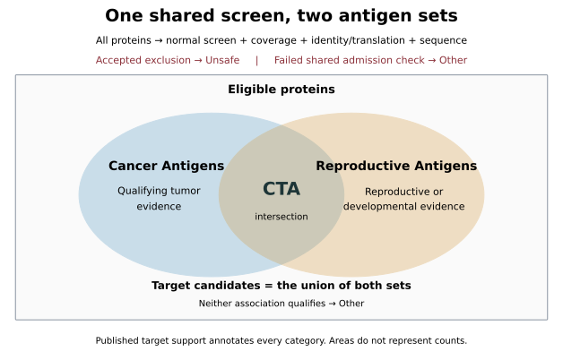
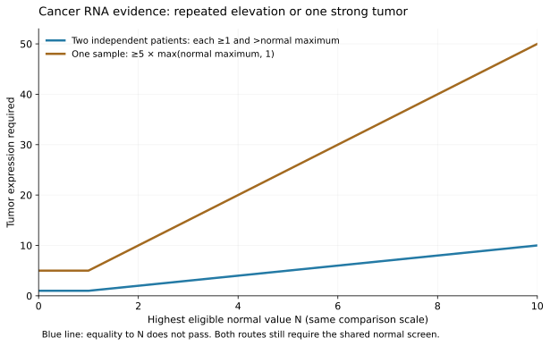

# Cancer and Reproductive Antigens

**Cancer/Testis Antigens are the intersection of Cancer Antigens and Reproductive
Antigens. Both sets use the same normal-tissue, coverage, translation and sequence
requirements. Their union is called Target candidates.**

The catalog has been rebuilt under `oncoref.target-selection.2026-11-09.1`:
**638 CTA, 260 Cancer Antigen only, 22 Reproductive Antigen only, 714 Other and
18,259 Unsafe**. That gives 898 Cancer Antigens, 660 Reproductive Antigens and
920 Target candidates. [Browse every protein and category change](audits/target-selection-20261109/rebuild/report.html).
The [1.36.0 catalog](cta-selection.md) retains its earlier counts and sequence
downloads as a separate versioned snapshot.

The [threshold inventory, patient-mapping correction and named CTA placements](audits/target-selection-20261109/policy-reference/index.md) explain the complete rules and current calls.

**The rebuild remains draft.** [The original 250-protein audit](audits/target-selection-20261109/scrutiny/index.md)
identifies tumor-source dependence, low-abundance matches and specialized normal
compartments requiring review. The counts describe rule matches, not experimentally
validated tumor antigens. Exact source-table claims now separate published target
nominations from reproductive-only background lists.

The [threshold comparison](audits/target-selection-20261109/thresholds/index.md)
tests 516 combinations of abundance, enrichment, percentile and Disposable-cap
rules. Its recommended next draft keeps the two-patient route, raises the
single-tumor requirement from fivefold to tenfold, and adds independent Disposable
caps of 32 TPM and 32 nTPM in their respective panels. That would give **630 CTA, 250 Cancer Antigen only,
30 Reproductive Antigen only, 724 Other and 18,259 Unsafe**. These are proposed
counts; the current rebuilt catalog above has not been relabeled.

[Illustrated report](audits/target-selection-20261109/report.html) ·
[Machine-readable definition](audits/target-selection-20261109/definition.json)



## One shared eligibility screen

Every protein is assessed, including proteins without a published target nomination
or a qualifying translation. **An accepted normal-tissue or applicable clinical
exclusion establishes Unsafe.** Missing or conflicting evidence does not.

| Check | Requirement | Failure |
|---|---|---|
| Normal expression | Pass all applicable bulk, cell, immune, rare-cell, protein and reviewed-knowledge rules | Unsafe for accepted exclusions; otherwise Other:Review |
| Required coverage | Complete combined normal bulk panel for every member locus; retain observed findings from supplemental panels | Other:Review |
| Identity and translation | Qualifying coding reference or supported noncanonical ORF; complete approved representative; resolve conflicting coding evidence | Other:Review |
| Sequence | Resolve nested proteins independently; fewer than 95% of 9-mers contained in Unsafe proteins | Other:Sequence |

The [tissue and cell registry](tissue-hazards.md) and
[released normal-expression rules](cta-selection.md#uniform-human-rules) supply
the normal screen. The RNA bases of 4, 8 and 16 are screening cutoffs for Vital,
Protected and Manageable contexts. The existing IHC-dependent adjustments remain
versioned screening conventions; negative staining does not demonstrate a precise
increase in tolerable RNA or a measured injury threshold.

Both antigen sets use the **same defined reproductive and Disposable allowances**.
Expression in a Disposable compartment can coexist with either membership.
Immune cells, blood vessels and other protected cells inside a reproductive organ
retain their own cell-specific assessment. An organ label does not exempt them.

The [expression-maxima and Disposable-cap audit](audits/target-selection-20261109/expression-maxima/index.md)
tests two additional requirements: cancer or reproductive/developmental expression
must exceed every measured nonreproductive value, and Disposable expression must
stay below a fixed cap. The maximum rule removes zero of the 920 candidates in
the current native-TPM panel; a 16-TPM Disposable cap removes LCE3C. This panel
contains appendix, gallbladder and tonsil, with no isolated hair-follicle TPM
measurements. The audit reports single-cell nTPM separately. These are
counterfactual counts; no new cap has been applied to the catalog.

Reference selection remains [MANE Select first, Ensembl canonical second, with
completeness checks and reviewed exceptions](audits/cta-transcript-selection-20261108/index.md).
An annotated coding reference can qualify without experimental protein detection.
RNA, endogenous protein, surface localization and peptide–HLA presentation remain
separate evidence fields.

## Cancer evidence

For a protein, let **N** be the highest supported measurement in a declared,
compatible healthy-tissue/cell panel, excluding the specifically allowed
reproductive and Disposable compartments. Let **T** be its value in a qualified
tumor sample. RNA qualifies through either route:

1. **Repeated expression:** at least two independent patients each have
   `T ≥ 1` and `T > N`.
2. **One strongly enriched tumor:** at least one sample has
   `T ≥ 5 × max(N, 1)`.

The values use the panel's declared native TPM, nTPM or pTPM scale. The second
route therefore requires at least 5 units when N is below 1. The floor prevents
trace expression from qualifying against a zero normal measurement. Equality to
N does not pass the repeated route; equality to the fivefold threshold passes
the single-tumor route. Two samples from the same patient count once.

| Highest eligible normal value | Two independent tumors | One tumor |
|---:|---|---|
| 0 | Each ≥1 | ≥5 |
| 0.4 | Each ≥1 | ≥5 |
| 1 | Each >1 | ≥5 |
| 3 | Each >3 | ≥15 |
| 8 | Each >8 | ≥40 |

These are selection conventions. Passing either route still requires the shared
eligibility screen. A tumor at 100 does not cancel an exclusion from normal cells
at 20. The two-tumor route can pass with a small difference above N; it establishes
repeated elevation, not a large fold change or statistical significance.



**Use compatible measurements.** A comparison records its source versions,
quantification and normalization methods, context panel and sample identities.
Matching unit names alone are insufficient: processing differences can confound
TCGA/GTEx comparisons. [Wang et al., 2018](https://pmc.ncbi.nlm.nih.gov/articles/PMC5903355/).
TPM, HPA nTPM, pTPM and single-cell CP10K are not pooled into one maximum.
Incompatible supplemental panels still enforce their own normal-exclusion rules.

N is the maximum of the declared panel's observations, with the source statistic
retained. A maximum across tissue means is not a maximum across individual
healthy donors. Missing required contexts leave the comparison unassessed;
missing values never become zero. This evaluator does not replace a required
panel with a convenient subset. Quality failures and unresolved paralog or
proteoform attribution cannot supply qualifying tumor observations.

Reviewed reliable tumor protein remains a separate positive cancer-evidence route,
with exact identity, reagent or peptide scope and source citations. Qualitative
IHC is not converted to an RNA fold change.

## Reproductive and developmental evidence

Reproductive Antigens include **adult reproductive, placental, extraembryonic,
embryonic and fetal** associations. Keep the named branch, stage, donor support and
source next to each assignment.

RNA association uses a detection floor of **1 native TPM/nTPM**, with existing
support requirements: reproductive cell clusters need at least 20 reads;
developmental lineage means need at least 20 cells, five positive cells and 10%
positive cells, with positivity measured at ≥1 TPM. Reliable mapped reproductive
IHC or reviewed human reproductive protein can also establish association.
HPA uses 1 nTPM for detection; OncoRef's application to other declared assays is
a policy choice. [HPA v23 methods](https://v23.proteinatlas.org/about/assays%2Bannotation).

**Reproductive concentration is descriptive, not an admission gate.** The old HPA
score compares adult/placental expression with adult normal tissues. It did not
measure embryonic/fetal concentration. Removing its veto gives both routes the
same admission logic; the score, source panel and missing developmental comparison
remain visible.

## Final categories

After the shared screen, cancer and reproductive evidence are assessed independently.

| Cancer evidence qualifies | Reproductive evidence qualifies | Display category |
|---|---|---|
| Yes | Yes | **CTA** |
| Yes | No qualifying evidence recorded | **Cancer Antigen only** |
| No qualifying evidence recorded | Yes | **Reproductive Antigen only** |
| No | No | **Other:Expression** |

An unassessed association remains marked unassessed. It does not erase a qualified
membership in the other set. If neither route qualifies and a route is unassessed,
the result is Other:Review. Missing required normal coverage blocks both sets.
Accepted exclusions take precedence over every positive association.

“Only” describes set membership. It does not claim that the protein is absent
from all reproductive tissues or all cancers. **Target candidates = Cancer
Antigens ∪ Reproductive Antigens**; the name does not assert clinical safety.
Disposable-only proteins and proteins low everywhere remain Other unless one of
the two positive association routes also qualifies.

## Published target support and paper claims

A curated published target nomination is **additional supporting evidence** and a
filterable subset within each antigen set. Publication is not required for membership,
and cannot override Unsafe evidence or an unresolved admission requirement.

Keep each protein–paper link, including links attached to Other and Unsafe proteins.
For each occurrence retain the citation and URL, exact mapped loci or proteoform,
table/figure when available, claim, experimental system and attribution limits.

| Paper role | What it contributes |
|---|---|
| Catalog or explicit target nomination | Prior nomination as a possible cancer, CTA or oncofetal target |
| Reproductive/developmental biology | Positive association with a tissue, cell program or stage |
| Tumor expression | Tumor RNA or protein evidence in the reported samples |
| Protein identity and translation | Evidence for or against the proposed protein or proteoform |
| Immune recognition or therapeutic study | The tested antigen, receptor/product, model or trial |
| Normal-tissue evidence | Normal production, physiological function or counterevidence |
| Background screen or reused program | Measured/program membership; not an individual target nomination |

The **core paper set** covers the curated catalog efficiently. **Supplementary
papers** retain independent experiments, specificity, normal-tissue findings and
other evidence even when their gene lists overlap the core. Overlapping lists do
not constitute independent experimental replication.

`cta_literature.attestations()` joins all retained occurrences to their citations
and original claim records. `published_nomination` identifies curated catalog
nominations; source-wide roles do not turn every gene in a paper into a target.
`publication_claims` retains exact table tags, files, sheets and rows;
`nomination_gene_ids` identifies the supported member loci. For example, da Silva's
testis-biased background and tumor proteomics tables remain separate from its
745-gene tumor-positive catalog. The source DOI alone cannot establish nomination.
Individual target experiments remain visible in their reviewed links and roles.
`current_coverage()` reports broader paper coverage, which also includes biological
and adverse evidence. A paper-covered protein is not necessarily a published target.

## Rebuilt catalog and API

```python
from oncoref import target_selection, cta_literature

contract = target_selection.definition()
counts = target_selection.metadata()["summary"]
catalog = target_selection.results()
changes = target_selection.results(changed_only=True)
cancer_only = target_selection.results(category="Cancer Antigen only")
h2bw2 = target_selection.results("H2BW2")
links = cta_literature.attestations("ENSG00000183128")
# target_selection.assess_cancer_rna(tumors, normals, ...) returns a cited receipt.
# target_selection.classify(assessed_facts) returns both memberships and one category.
```

The new evaluator accepts evidence assessed under this contract. Legacy cancer
`>0` flags and reproductive `≥5` flags cannot substitute for the new checks.
The rebuild replays accepted normal-evidence curation, recomputes association at
1 unit, resolves tumor locus identities and counts confirmed independent patients.
All 957 proteins passing the shared screen have complete native-TPM comparison
coverage across the required 36 nonreproductive anatomy contexts. The normal
reference also includes measured brain subregions and immune-cell summaries.
The 130 included tumor cohort views are deduplicated by physical sample and known
participant identifiers.

These are source-native gene TPM comparisons, without cross-study batch correction.
N is the maximum of supported context summaries: tissue means, GTEx donor medians
and supported immune statistics. It is not the maximum across all healthy donors.
The stored three-sample NUTM matrix fails the nonnegative-TPM check and is excluded.
[Comparison methods](audits/target-selection-20261109/rebuild/comparison.json) ·
[Cohort coverage](audits/target-selection-20261109/rebuild/tumor-source-coverage.csv) ·
[Input hashes](audits/target-selection-20261109/rebuild/inputs.json).

The new `target_selection.results()` includes selected transcript IDs, sequence
hashes, measurements and linked paper records. `cta_selection.results()` and
sequence downloads retain the 1.36.0 snapshot and its policy identity; the new
catalog does not silently change those assets.
